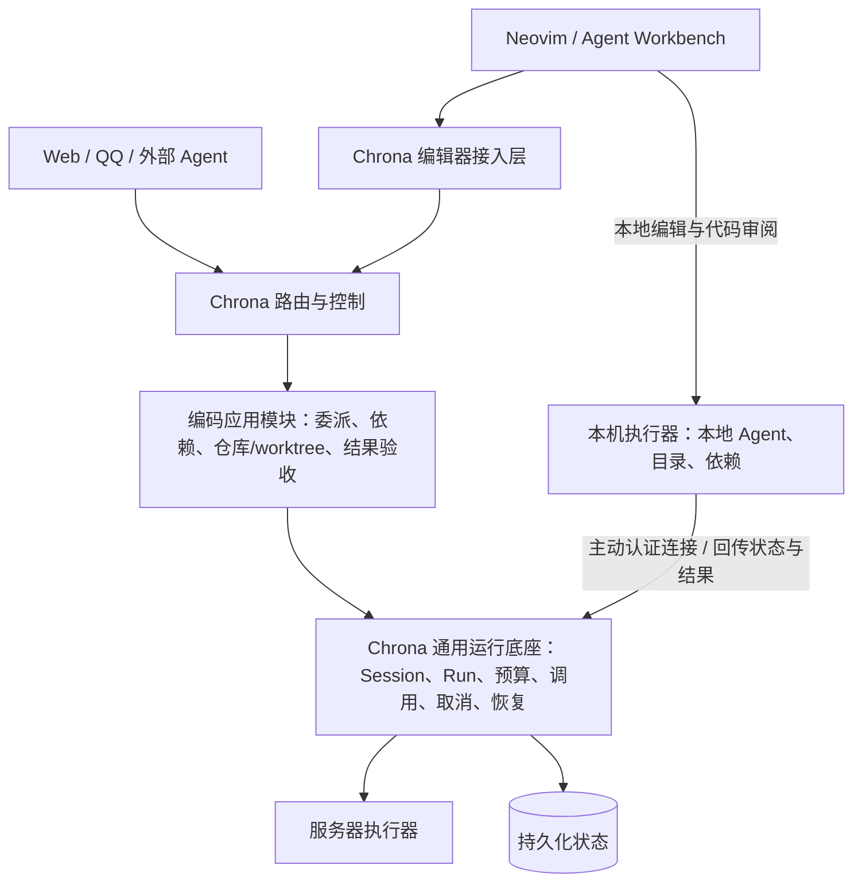

# Chrona × Agent Workbench：多入口与多位置执行方案

> 已由[统一开发方案](chrona-workbench-unified-development-plan.md)接替。后续实施、契约冻结与多 Agent 派工统一使用新文档；本文保留原讨论背景，未决建议以统一方案的取舍为准。

日期：2026-11-05  
状态：原讨论交接稿；已合并进统一开发方案，不再独立派工。  
授权范围：本轮仅整理文档；本文不授权编码、部署、数据迁移、连接设备或启动 Agent。

## 1. 阅读目的与核心结论

将 Agent Workbench 作为 Chrona 的 Neovim 客户端：Chrona 保持在服务器上常驻，管理工作状态与执行；编码可在服务器执行，也可由个人电脑上的轻量执行器完成。Neovim、Chrona 服务和 Agent 执行环境的位置相互独立。

优先复用 Chrona 现有 TypeScript/Bun 运行底座，不另起 Go/Rust 编排内核。编码相关的工作委派、仓库/worktree 和结果验收放进独立应用模块；通用执行机制才扩展进内核。语言选择可在明确瓶颈后局部调整，不先进行重写。

目标体验：在 Neovim 发起工作，关闭编辑器后后台继续处理；从 Web/QQ 查看进展与回答问题；重新打开 Neovim 后查看执行内容、审阅代码。跨入口关联和实时会话接入均是待实现目标，不是已交付能力。

## 2. 背景与用户约束

- 用户的 Chrona 目前部署在服务器，执行环境也在服务器上，需要保留 24 小时服务。
- 用户希望 Agent Workbench 获得类似 Orca/Herdr 的多 Agent 管理与编排能力。
- 用户提出以自己的 Chrona 项目作为根基，而非在 Neovim 插件里重建一套运行系统。
- 本机编码需要本机文件、依赖和工具；不能因此把整个 Chrona 搬回个人电脑。
- 当前处于架构讨论阶段，下一位 Agent 应继续评估和收敛方案，不能把这份文档视为实施授权。

## 3. 已认可的方向与尚未拍板的建议

### 3.1 已讨论认可的总体方向

1. Agent Workbench 是 Chrona 的编辑器入口，与 Web、QQ 共用后台能力。
2. Chrona 继续服务器常驻，执行位置与服务位置分开。
3. 复用现有 Chrona 技术栈和可靠性机制，避免两套系统重复维护执行、取消、恢复和权限。
4. 具体业务遵守 Chrona 的模块边界，不能为编码入口把所有开发工具逻辑塞进通用内核。

### 3.2 建议方案，仍需确认具体设计

- 本机运行独立于 Neovim 的轻量执行器，主动连接服务器。
- 先实现服务器执行与编辑器接入，再扩展一个固定本机执行器；具体先后顺序可调整。
- 第一版固定执行位置，不自动迁移运行中的工作，不做后台双向文件同步。
- 失联后本机执行器经过有限宽限期停止并保存现场；宽限期、停止范围和是否允许授权离线执行仍待定。
- 传输协议、API 名称、数据库字段、模块名称和精确状态枚举尚未确定。

## 4. 当前代码事实与核查范围

参考源码基线：

- Chrona：`8294408fb260f14607b9b3d8199f2b1a8d4e54f8`。
- Agent Workbench：`3f633c9ce4855958fc5eed51d465cee4447b1584`。
- Chrona 工作树另有既存未提交 Web/模块生命周期改动；本次未修改这些文件。commit 不代表整个工作树快照。
- 本轮为有界源码与文档阅读；未运行 Chrona 测试、真实模型、远程执行或部署验证。源码机制存在不等于已在用户环境验收。

### 4.1 Chrona 已有的可复用基础

| 能力 | 当前实现与入口 |
| --- | --- |
| 独立服务运行时 | `apps/server/src/steward-runtime.ts`：tick、Provider 句柄、运行时启动与停止 |
| Session / Run 分离 | `prisma/schema.prisma`：会话、一次处理、Provider session ID、来源会话关系 |
| 持久运行队列 | `packages/engine/src/modules/steward/runs.ts`：事务领取、deadline/lease、次数限制、完成与续跑 |
| 执行适配 | `packages/contracts/src/steward/index.ts`：`ProviderAdapter`，含 `start/inject/abort/done` |
| Pi 生命周期 | `packages/integrations/src/steward/pi-provider.ts`：RPC、完成核实、消息注入、取消与子进程退出 |
| 调用与回执 | `packages/engine/src/modules/steward/module-calls.ts`：真实调用方、幂等键、事务 outbox、异步结果和未知状态 |
| 委派回报雏形 | `runs.ts`：`originSessionId`、构建结果回传与有界唤醒原会话 |
| 控制和可观测性 | `provider-channel.ts`：安全进度、用量、运行绑定的用户请求、答复和取消 |
| 可靠性测试资产 | `run-recovery.bun.test.ts` 等覆盖续跑上限、未知结果、取消和租约；本轮仅阅读，未执行 |

### 4.2 当前限制

- Run cwd 固定为服务端 `<dataDir>/sessions/<sessionId>`，入队时就在服务端创建目录。
- 运行时配置一个 Provider；Pi 使用服务所在宿主的命令/profile，以及 loopback 工具桥。
- `claimNext` 在同一 workspace、同一 lane 已有 running Run 时不再领取；不是同 lane 多 worker 调度器。
- Provider 事件契约仅传安全摘要和受限交互，明确不承载原始 thinking 或工具 payload；不足以驱动 Workbench 完整聊天界面。
- 当前 `Workspace` 是会话、模块、设置等数据的归属容器，不能直接等同 Git worktree、机器或 Neovim tab。
- 现有 `provider.wake` 创建新会话，但不是带设备选择、独立执行规格和验收关系的通用 worker 分派接口。
- Chrona 的产品目标排除重型 DAG/节点 workflow 引擎，项目规则也明确移除了旧 task/goal/plan 系统。此次讨论不是恢复旧系统的决定。

### 4.3 Agent Workbench 的衔接点

另一仓库位于 `/home/saya/workspace/agent-workbench.nvim`：

- `lua/agent-workbench/backends/init.lua`：现有会话后端注册机制。
- `lua/agent-workbench/backends/pi.lua`：语义会话事件与能力声明。
- `lua/agent-workbench/sessions/manager.lua`：会话与 UI 生命周期；当前退出 Neovim 时关闭 backend。
- `lua/agent-workbench/rpc.lua`：当前直接启动并控制 Pi 子进程。

已有会话、Attention、工作区和 diff review 可以复用。新增 Chrona 接入需要区分断开前端与停止执行；编排客户端也不应把跨会话操作全部塞进 `BackendSession`。

## 5. 建议架构与职责

图表示职责与连接意图，不是已确定的协议或进程划分。

| 层 | 应负责的内容 |
| --- | --- |
| Chrona 通用底座 | 执行身份与归属、队列与配额、运行生命周期、消息投递、取消、权限、审计和恢复 |
| 编码应用模块 | 仓库/worktree、工作目标、委派关系、简单依赖、测试证据、产物和人工验收 |
| 执行器 | 在明确设备与授权目录执行；拥有本地进程，保存执行现场，回传状态并处理取消 |
| Agent 适配器 | 连接 Pi 或后续其他 Agent，规范化启动、注入、停止和完成事件 |
| Neovim 前端 | buffer、光标、草稿、编辑器上下文、聊天呈现、Attention、代码导航和 diff review |

内核处理确定的执行规则；人或协调者 Agent 决定如何拆解工作、选择方法和评估产物。编码工作的数据与规则不要求成为通用内核的一级任务系统。

执行完成、结果生成、人工接受和代码合并是不同事实，需分别表达。沿用现有 Session/Run；具体工作记录由编码模块维护，不因增加一个抽象名就复制已有执行队列。

## 6. 执行位置与文件边界

### 6.1 两种明确模式

- **服务器项目模式**：代码和依赖在服务器 checkout/worktree；本机关闭后仍可执行。Neovim 如何远程编辑和审阅需单独设计。
- **本机项目模式**：使用本机项目、依赖、模型配置和工具；电脑必须运行且符合连接策略。

服务 24 小时在线不等于离线电脑能够执行。不要承诺把本机当前进程或未提交现场无缝迁移到服务器。

### 6.2 建议的身份与映射

- 每台执行设备有稳定身份；每次执行绑定执行器与唯一执行尝试。
- 项目/worktree 路径由对应执行器解析；服务器上的绝对路径不代表本机路径。
- 目录映射应有设备身份与授权范围，不能让远端消息直接变成任意宿主路径访问。
- Agent 会话身份应包含 Provider 和执行环境归属，不能假定 Provider session ID 可直接跨机器使用。
- 内部 lease/attempt 标识用于拒绝旧执行回执；它不自动阻止旧进程继续写本地文件，需要执行器配合与工作区归属管理。

### 6.3 代码与产物传递

- worktree、依赖、完整执行现场默认保留在执行设备。
- Chrona 保存执行归属、状态、必要产物及其版本/位置引用。
- 跨设备传递采用明确的 commit、patch 或版本化产物；涉及上传、推送和私人代码范围时需遵循用户授权。
- 未保存的 Neovim buffer 通过明确保存或快照交给 Agent，避免宣称运行的是最新编辑内容。
- 首版不自动双向同步项目目录，不自动把本机工作改派到服务器。

## 7. 断连、取消与恢复语义

以下为建议行为，具体状态名称待定：

| 场景 | 建议行为 |
| --- | --- |
| Neovim 关闭、执行器仍在线 | 仅断开视图，执行继续；重连读取状态与缺失事件 |
| 尚未执行、目标设备离线 | 等待目标设备；期限到达按已确认规则过期或通知 |
| 网络断开、执行进程可能仍活着 | 状态待确认，保留归属；心跳超时不能证明退出，也不授权重复派发 |
| 本机重新连接 | 以执行尝试 ID 与事件序号对账，去重，再处理后续动作 |
| 设备重启、原进程已结束 | 保存中断与产物事实；续接是新的受控执行，不伪装成原进程存活 |
| 用户请求停止但设备离线 | 持久记录请求、撤销服务端能力；收到执行端确认前不宣称已停止 |
| 结果已生成但最终回执丢失 | 查询与核对现有结果，不盲目重跑 |
| 服务器重启 | 从持久化恢复并与执行器对账，不仅依赖内存 liveRuns |

建议首版失联执行有有限宽限期并停止保存现场；停止进程树、长命令、停止失败和结果未知的处理必须纳入设计。撤销服务器能力不能撤回已发生的外部效果，也不能独自终止离线设备的本地工具。

## 8. 接入协议与权限原则

- 本机执行器主动建立经认证连接，不默认要求个人电脑开放入站端口；具体选 WebSocket、流式 HTTP 或其他传输待设计。
- 执行器使用单独且可撤销的凭据，不能持有完整 owner API key。
- 命令、执行与消息有稳定 ID；领取去重、事件顺序、重连游标和取消回执须有明确契约。
- 不复制 Chrona 数据库到本机；服务端保存权威工作状态，执行器保存必要本地执行日志与待回传事件，并在重连时对账。
- 现有 Provider token、loopback 工具桥、审批身份不能直接跨网络暴露；须重新限定远端可访问的能力与有效期。
- 本机模型认证可留在本机，服务器不默认获得本机私人 profile 或所有凭据。
- 编辑器详细会话流是新增受控通道：认证、脱敏、大小上限、背压、历史保留和重连需设计。保持现有安全摘要通道语义，不把原始 RPC 全写入 Audit。
- 多入口共享获准工作的状态，不默认共享所有私人上下文。QQ 可看摘要与决定，Web 可看成果，Neovim 可看授权的代码与详细执行内容。
- 工作关联可跨入口；回复投递、通知预算和主动推送应沿用 Chrona 规则，不能因新增 Neovim 绕开 notify。

## 9. 分阶段建议与验收

### 阶段 A：服务器执行与 Neovim 接入

先跑通一个工作：Neovim 提交明确请求，Chrona 管理一次服务器 Pi 执行，保存结果，Neovim 重连后继续查看并审阅。

验收：关闭 Neovim 不取消执行；补充消息、用户问题与取消定位到正确 Run；重连不重复提交工作；执行结束与人工验收分开。

### 阶段 B：一个固定本机执行器

增加设备配对、明确项目映射、主动连接、执行绑定、事件回传、取消确认和离线等待；本机执行器独立于 Neovim。

验收：本机文件由本机执行；编辑器关闭后执行可继续；设备离线不自动转派；断网重连不重复运行；离线取消保持待确认；服务器重启能与执行器对账。

### 阶段 C：受控并行编码

扩展有界并发、独立 worktree、父子工作结果回报和简单依赖。复用已有 Run 队列，保护前台交互和模块构建语义。

验收：两个 worker 可并行且不互相覆盖；结果回到正确工作；同一会话保持所需串行；故障、取消和重复事件不触发重复集成。

### 首版暂缓

自动跨设备迁移、后台双向项目同步、任意 CLI 的终端识别、通用 DAG 编辑器、多租户平台、自动合并和大规模集群调度。

上述是建议的分期，不是已批准开发计划；目前没有可靠的细化工时估计。

## 10. 下一轮最值得讨论的问题

1. 首个场景是服务器仓库还是本机仓库？能否用同一个小项目验证完整闭环？
2. Neovim 接入采用正式入口模块还是其他经过路由的客户端适配？详细流如何与现有会话接口配合？
3. 编码执行上下文怎样与个人管家 prompt、权限和资源配置区分，避免破坏现有 Provider 行为？
4. 哪些机制进入内核，哪些属于编码模块？如何在不复制队列的情况下让模块发起受控执行？
5. 设备身份、项目映射、执行尝试和旧回执拒绝如何建模？
6. 网络失联后宽限期多长，是否停止全部本地子进程，停止失败如何显示？
7. 第一版模型/profile 是否全部由执行设备配置？后续怎样支持多 Provider 选择？
8. 完整聊天流保存在哪里，保留哪些内容？如何限制敏感数据、输出量与重连成本？
9. worktree 创建、验证、保留、人工接受与清理分别由谁负责？
10. 如何兼容 Workbench 现有直连 Pi 模式，以及 Chrona 现有聊天、构建和运行恢复？是否保留直连模式尚未决策。

## 11. 供下一个 Agent 使用的交接提示

> 请先阅读本文件以及 Chrona 的 AGENTS.md、docs/zh/steward-goals.md、docs/zh/architecture.md、docs/zh/provider-runtime.md。我们希望将 Agent Workbench 作为 Chrona 的 Neovim 入口，保留服务器 Chrona 24 小时常驻，并按需增加本机执行器。请结合当前代码继续收敛内核/编码模块/执行器/前端边界，优先讨论第一阶段最小闭环、协议与断连恢复；区分已实现、建议和待确认事项。本文不授权编码、部署、连接设备或运行真实 Agent。仓库有用户未提交改动，请先检查并保留。不要恢复旧 task/goal/plan 系统，不先重写为 Go/Rust，也不要用心跳超时证明进程退出。

## 12. 参考阅读

本文件是新增讨论稿，不覆盖现有产品目标与当前架构文档：

- [Chrona 设计目标](steward-goals.md)
- [当前架构](architecture.md)
- [Provider 运行](provider-runtime.md)
- [模块依赖方向](module-dependency-direction.md)
- [安全机制简化](security-simplification.md)
- [Chrona 仓库指引](../../AGENTS.md)
- [Agent Workbench README](../../../agent-workbench.nvim/README.md)（同级本机仓库链接，不保证独立发布可用）
