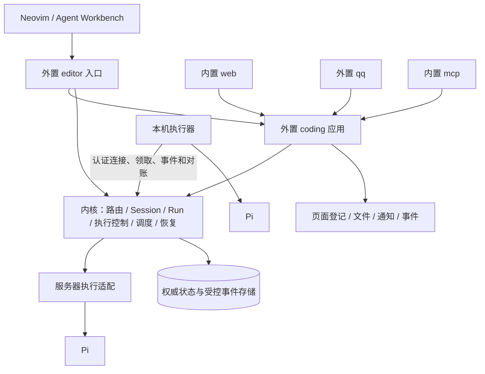
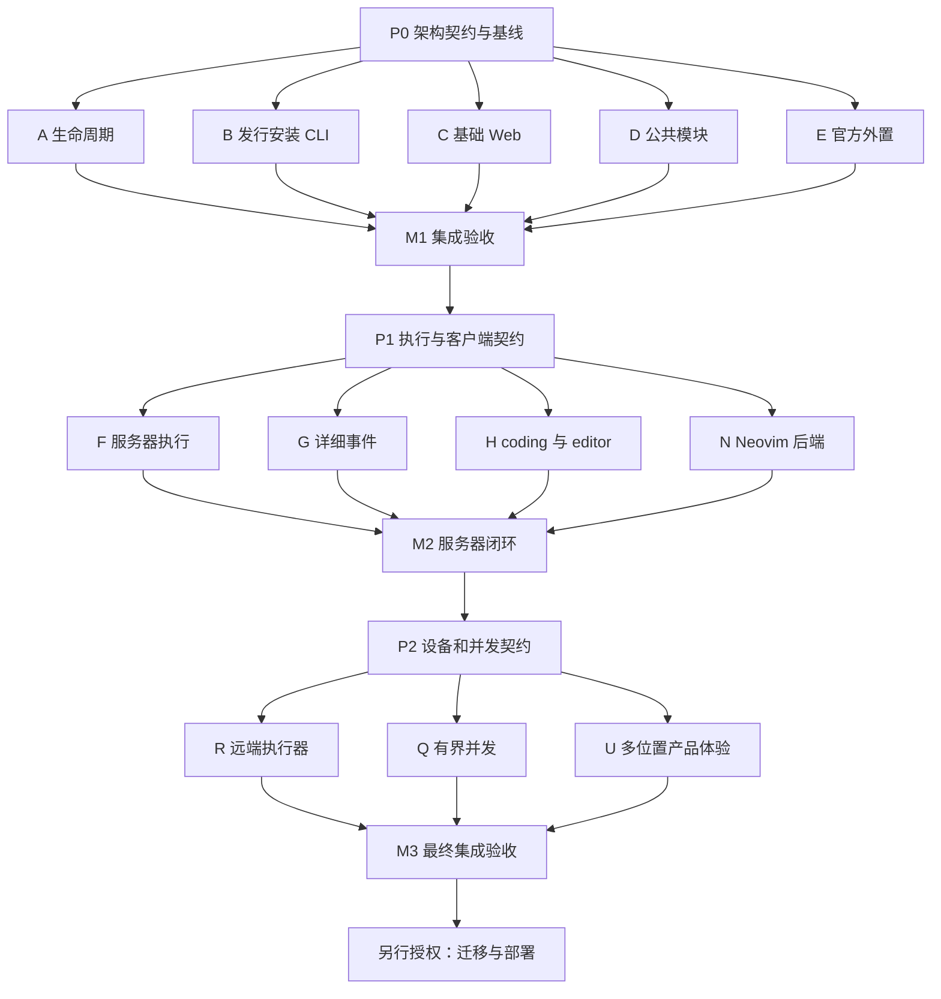

# Chrona 最小模块架构与 Agent Workbench：统一开发方案

日期：2026-11-05；最终开发签收：2026-11-06。  
状态：**M1、M2、M3 开发集成验收完成**。[P1](chrona-workbench-p1-contract.md) 与 `P2-20261106` [固定设备契约](chrona-workbench-p2-contract.md)已冻结并实现。最终原树 typecheck、required lint、boundaries、1326 Bun / 61 API、16 个补充测试文件、Workbench 806 successes、实际 Neovim GUI、Linux x64 build/smoke 及 compiled executor 到真实 Hono/runtime/SQLite/fakePi/systemd 的丢 ACK、重启、撤权和原身份 drain 闭环均通过。独立复核发现的八项问题及发布构建环境缺陷均关闭；完整快照、失败历史、29 条既有 lint warnings、环境 skips 与精确边界见 [M3 开发验收记录](chrona-workbench-m3-acceptance.md)。这不代表生产部署、公开发行、真实模型或个人设备安装验收。M1、M2 的历史证据分别保留于其[验收记录](chrona-workbench-m1-acceptance.md)及 [M2 记录](chrona-workbench-m2-acceptance.md)。
范围：Chrona 架构简化、服务器编码闭环、Neovim 客户端、本机执行器、受控并行编码。  
授权：用户随后已批准继续 M2，并于 2026-11-05 明确授权整合已完成交付、清理无用任务 worktree、继续后续任务。F/G/H 按冻结文件分工实施；真实模型/个人设备、真实数据库迁移、部署、提交与推送仍未授权。后续执行者以用户实际授权和各包派工为范围。

本文接替以下两份文档作为后续开发与派工的统一入口，原文保留为背景，不再独立派工：

- [最小模块架构原方案](minimal-module-architecture-plan.md)
- [Agent Workbench 原讨论稿](agent-workbench-execution-design.md)

本文保留原阶段设计与派工条款；当前实际实现、逐项证据与未验证环境以各阶段验收记录为准，不能将设计条款当作超出证据的承诺；开发前仍须阅读对应仓库 AGENTS.md、当前架构和涉及目录的指引。与当前规则冲突的目标变更，由协调者在实现时同步规则和文档，不能假装目标已经实现。

## 1. 交付目标与范围

### 1.1 最终使用闭环

1. Chrona 在服务器常驻；用户在 Web、QQ、Neovim 或 owner MCP 使用获准的应用能力。
2. 内核和内置模块代码随发行版更新；业务能力通过可独立安装、更新的外置模块生长。
3. 用户在 Neovim 指定项目与执行位置，交代编码工作；关闭编辑器只断开视图，工作继续。
4. 服务器或个人电脑上的执行器在明确授权的目录内运行 Pi，Chrona 保存执行身份、状态、取消请求和必要成果引用。
5. 用户可从其他入口查看摘要、回答仍有效的问题；回到 Neovim 后恢复工作视图、查看授权的会话内容和 diff。
6. 多个 worker 可以在独立 worktree 中执行；执行完成、成果生成、人工接受、代码合并分别记录。
7. 失联、服务器重启、重复请求和丢失回执不造成盲目重跑、重复集成或伪造成功。

### 1.2 本方案覆盖的成品

| 交付点 | 包含内容 | 可单独验收 |
| --- | --- | --- |
| M1：最小模块架构 | 内置不可变、外置安装与演化、扩展登记、网页/CLI/发行完整 | 可以，全新数据目录 |
| M2：服务器编码闭环 | 编码应用、编辑器入口、受控项目执行、详细事件与重连、Neovim 后端 | 可以，单个服务器项目和单次执行 |
| M3：完整执行能力 | 一个固定本机执行器、有界并行、独立 worktree、跨入口操作与故障对账 | 最终验收 |

M1 不代表 Workbench 已可用，M2 不代表远端设备或多 worker 已可用。三个交付点共用架构和运行底座，不保留临时双轨实现。

### 1.3 非目标

不重写为 Go/Rust；不另建 Agent loop、第二套执行队列、通用 DAG 编辑器、多租户平台或插件钩子系统。不做自动跨设备迁移、后台双向项目同步、自动合并、任意 CLI 终端识别或大规模集群调度。

旧生产数据迁移与部署独立处理，不成为本次正常运行路径的一部分。正常的未来模块数据升级、备份和恢复仍属成品职责。

## 2. 核查基础与当前缺口

以下为 2026-11-05 编写方案时的核查基础，保留为决策背景；之后的 M1 完整测试与发行结果见验收记录，不代表真实部署。P1 准备已重新核对当前代码，以下项目执行/详细流缺口仍存在：

- `runs.ts`：入队固定创建 `<dataDir>/sessions/<sessionId>`；同一 workspace/lane 已有 running 时不再领取，同一会话亦受串行约束。
- `system/provider.ts`：`provider.wake` 只接受 prompt，创建模块会话并排到 background；不是项目/设备可选的通用执行接口。
- `tick.ts`：普通运行组装个人管家提示词、偏好、日程、记忆与工具目录，再调用单一 Provider。
- `packages/contracts/src/steward/index.ts`：`ProviderRunInput` / `ProviderAdapter` 已有 start、inject、abort、done；运行事件仅允许安全摘要与运行绑定问题。
- `packages/contracts/src/steward/provider.ts`：现有事件不是完整聊天记录，不能直接承担编辑器详细流。
- Workbench `backends/init.lua`、`backends/pi.lua`：已有后端注册、语义事件和能力声明，可增加 Chrona 后端；不能假设所有 UI 路径已完全脱离 Pi raw RPC。

实施前重新记录两仓库 HEAD、工作区 diff 和未跟踪文件。M1 已保留原用户 Web、system/modules 和生命周期改动，并冻结为运行时树 `1c7ec0a95d0a3f3a6d961133e5f78a89ffdf2f37`（530 文件）；文档收口独立增量不改运行时。只读准备时 Workbench HEAD 为 `3f633c9ce4855958fc5eed51d465cee4447b1584`、工作树干净；未来派工仍须重新确认，两仓库版本不互相替代。

> 🧠 **From Hindsight memory (Key decisions and rationale)** — Chrona 复用持久状态、预算、队列与恢复机制，Provider 负责推理及原生工具执行，不另建第二套 Agent loop。该方向已与上述当前接口和实现文档核对；历史旧任务系统不作为本方案模型。

## 3. 最终架构与职责



`coding`、`editor` 和下文 `executions.*` 是本方案建议的目标名称，由 P0 检查命名冲突后冻结。不是对现有接口已存在的声明。

### 3.1 三部分模块归属

| 归属 | 内容 | 代码更新方式 |
| --- | --- | --- |
| 内核 | chat、modules、schedules、provider、approvals、settings、secrets、activity、content、memory 转发；Session/Run、通用执行与执行器控制 | Chrona 发版 |
| 不可变内置 | web、mcp、files、notify、events | Chrona 发版 |
| 官方预装外置 | qq、remind、mind | 首次明确初始化；之后显式更新 |
| 可选外置 | memory-local、coding、editor、其他业务应用 | 显式安装、受检构建和更新 |

Provider 是内核使用的执行适配器；system/* 是内核接口的代码组织，不是第四类应用。内置和外置共用 SDK、路由、独立进程协议及 supervisor。

### 3.2 编码能力归属

| 层 | 负责 | 不负责 |
| --- | --- | --- |
| 内核 | 执行身份、归属、预算、队列、取消、权限、事件访问和恢复 | 仓库业务、工作分解、成果是否值得接受 |
| coding 外置应用 | 项目引用、工作目标、父子委派、简单依赖、worktree 生命周期、测试证据、成果版本、人工验收 | 自建 Pi 循环、自建运行队列、直接访问内核数据库 |
| editor 外置入口 | 编辑器认证后的协议适配、会话入口、工作操作与事件投影 | 新建私有权限系统、持有全局运行能力、直接改 Run |
| 执行器 | 对应设备的目录解析、Agent/命令进程、停止确认、本地日志与待回传事件 | 决定用户工作目标、自动改派设备、保存服务端数据库副本 |
| Provider 适配 | Pi 生命周期、注入、完成核实、语义事件规范化 | 业务任务调度、人工成果验收 |
| Workbench | buffer、草稿、聊天、Attention、代码导航、diff review、连接状态 | 服务器权威状态、本机后台执行器生命周期 |

worktree 的创建/检查/保留/清理由 coding 决定，通过执行设备上的受控操作完成；内核只识别执行资源和占用，不理解 Git 分支业务。跨入口共享的是获准工作的引用与操作，不把多个入口合并成同一个聊天会话。

### 3.3 公共能力扩展原则

外置应用不能覆盖内置代码、同名替代、覆写方法或注入任意 before/after 钩子。公共接口不足时修改 Chrona 本体并发版；不能要求 coding 自建执行系统来绕过限制。

当前单 Provider、服务端 cwd 和单 lane 串行是现状，不是永久契约。M1 保持现有运行行为；M2/M3 在同一 Session/Run 基础上有针对性地扩展，不以“简化”为由删掉后续所需的执行归属和恢复能力。

## 4. 模块简化必须完整保留的规则

### 4.1 身份与操作

- `Module.builtin` 是内置/外置的唯一类别来源；`ModuleVersion.source` 只记录来源。
- 内核接口名和发行内置名保留，即使数据库未初始化也不允许外置占用；manifest 不能自授 builtin。
- 对外统一投影 `origin: kernel/builtin/external` 和实际 `capabilities`，执行端仍逐次校验。
- 内核/内置拒绝动态 build、propose、组更新、代码 rollback、删除及任意历史候选激活；内置配置和业务数据可修改，支持暂停、重启和诊断。
- 外置支持受检安装、构建、更新、回滚、停用和确认后的删除；保留数据连续性及一次预交付启动失败回滚规则。
- 排队前、提交/激活前以及审批恢复后均校验身份；owner build、admin build、request-group 不能绕过。
- owner 有界构建的单次授权、精确模型、时限和提交上限保持不变；普通编码工作不能冒用该接口。

### 4.2 发行、安装与恢复

- 内置启动代码绑定当前可信发行资源，注册不经过外置提案/构建队列。发布前检查测试、类型和资源完整性；启动检查本机依赖与数据兼容。
- 内置不自动切换旧定制 hash；无法安全读取既有数据时停收业务事件并保留 rescue/admin。数据升级仍可要求备份和确认。
- 预装外置和用户外置共用检查/激活路径。初始化状态持久化，中断可继续，完成后重启或升级不复活已删除模块。
- 外置升级必须明确选择，不静默覆盖定制。支持随包资源和本地源码；`modules.install` 与 `chrona admin install` 复用相同路径。
- 服务端解析官方包名单，不通过安装参数任意读取宿主路径。本地源码继续使用 propose，不增加第二种更新算法。
- 安装/检查不阻塞基础入口或 tick；QQ 缺凭据显示待配置，memory-local 缺席不阻断普通对话。
- 删除旧 preserveCustomization、custom-builtin 和 rollback builtin 恢复语义；不保留过渡开关。

### 4.3 扩展登记与生命周期

web 页面、notify 渠道、events 订阅、memory 实现和 schedules 继续走 routed calls 与明确登记。真实调用方决定归属；重复 activated 幂等；停用停止新投递并隐藏/标明不可用；删除清理登记；更新/回滚校验回调工具契约，失效引用不得由其他模块替代。

应用数据私有，页面登记不复制业务数据库。files 只提供基础文件能力，分类/整理/研究属于外置业务。

新增执行能力后，应用停用与删除还必须满足：

- M2 首版在应用仍持有排队、运行或停止待确认的编码目录时，拒绝停用、代码切换和迁移，并返回先停止核对的冲突；用户先通过执行取消入口处理，确认释放后再停用。不得把停用请求伪造成停止完成。后续若改变为停用同时请求停止，须保留内核监管与原调用身份。
- 内核继续接收既有执行的取消确认、最终事件与对账；不能因为 editor/coding 进程停用而失去运行监管。
- 未结束执行、未知结果、未处理回调或活动入口关联阻止删除；首版返回可操作冲突，不自动丢弃会话或结果。
- 入口断开不取消工作；显式停用入口只影响其服务和新请求，已提交工作的归属仍在 coding/内核。
- M1 覆盖已有会话/运行关联；M2/M3 随新执行模型补齐相同校验，不在 M1 创建空设备模型。

## 5. 执行、会话与项目契约

### 5.1 最小身份模型

| 标识 | 权威持有者 | 语义 |
| --- | --- | --- |
| 工作 ID | coding | 用户交代的编码工作及验收关系，可关联多个会话/运行 |
| Session / Run ID | 内核 | 对话上下文与一次处理，沿用现有实体 |
| 执行尝试 ID | 内核 | 一次实际领取/启动的身份，隔离旧回执；不是第二个任务队列 |
| 执行器 ID | 内核登记、执行器证明 | 设备身份；服务器执行也有明确环境归属 |
| 项目/目录引用 | coding 业务引用 + 执行器映射 | 指向获准目录，不把服务器绝对路径当成本机路径 |
| Provider session ID | 适配器 | 与 Provider、执行器和执行上下文绑定，不跨机器直接复用 |
| command/request key | 内核/应用对应操作 | 重连重复请求去重；超时先查询，不换 key 盲目重发 |

协调者决定字段落在现有 Run/Session、关联表还是模块数据中；不重复保存可推导状态。排队、租约和运行终态由内核唯一写入，coding 的业务进度引用这些事实。

### 5.2 受控执行接口

建议通过内核 `executions` 系统接口提供以下语义，P1 冻结名称、输入输出和可见性：

| 语义 | 最少信息/行为 |
| --- | --- |
| start | 真实调用方、工作引用、幂等键、执行环境/项目引用、明确目标、预算与截止时间；返回稳定 Session/Run 引用 |
| get/list | 仅返回调用方有权查看的执行；包含请求与实际执行状态的区别 |
| send/answer | 定位会话、Run 和有效请求；校验去重、归属与请求期限 |
| cancel | 持久记录取消意图、撤销服务端能力；终止事实由执行端确认 |
| events | 有权限检查的快照/游标读取；详细内容另行受控，不改安全摘要语义 |
| reconcile | 执行器证明身份后提交尝试、进程/结果证据，拒绝过期尝试改变新状态 |

模块提交目标和引用，不自行指定 caller、lease、token 或任意宿主路径。owner、入口、coding 和执行器的可调用范围分别冻结；不让 executor 凭据调用 owner 工具目录。

首版单项目/单服务器执行即使用上述归属原则，但不提前实现用不到的设备管理 UI 或通用调度策略。

### 5.3 执行上下文

普通对话继续管家语义；编码执行使用受控的项目上下文，包括仓库规则、目标、选定资源和已授权目录。内核安全/预算/身份约束不能被应用 prompt 覆盖。

不把个人偏好、记忆、日程自动复制给每个编码 worker；按明确用途提供必要上下文。移除 tick 对 mind 的硬编码，应用自带业务协议；无 mind 时仍能普通对话和编码。

执行代码目录与会话日志目录分开。附件、待发送文件和成果路径按执行环境解析；远端路径只作为引用，不能让服务器按同名路径读取本机文件。未保存 buffer 必须明确保存或发送快照，并记录实际使用的版本。

### 5.4 队列和有界并发

M2 可保持单编码执行；M3 在现有 Run 队列上增加受控容量，不靠无限新增 lane 获得并行。

- 继续保护前台交互、模块构建预算和现有 build FIFO/owner 单次语义。
- 同一会话保持所需串行；同一可写项目位置/工作树不得同时交给多个尝试写入。
- 两个 worker 使用独立 worktree，可在同一设备有界并行；容量、每应用配额和全局预算同时生效。
- 分解、父子工作和简单依赖由 coding 管理；依赖满足后才申请下一次执行，不复制持久调度队列。
- 父工作取消停止后续派发，并向现有子执行发出取消；未知子结果阻止自动集成。

## 6. 接入、详细事件与本机执行器

### 6.1 首版协议基线

为让多 Agent 能独立实现，采用以下最小传输方向；各阶段契约门用无真实账号的探针验证现有监听/代理是否支持：

- 编辑器控制与查询：认证 HTTP JSON；事件采用带游标的有界读取，先支持长轮询。流式推送只在证明现有代理和客户端支持后作为同一语义的传输优化，不成为第二套协议。
- 本机执行器：主动 HTTPS 连接，领取命令采用有界长轮询，事件/确认采用幂等批量 POST；不要求个人电脑开放入站端口。
- 协议有版本、请求 ID、稳定错误结构、尝试 ID、事件序号和游标；P1/P2 发布可被 TS 和 Lua 共用的 JSON fixtures。
- editor 的客户端 API 通过模块 listen 提供，业务操作 routed 到 coding/内核；执行器控制端点属于内核装配，使用独立认证。
- 若代理对连接时长有限制，在契约门调整轮询时限；不能由 worker 私自切换 WebSocket 或写临时旁路。

### 6.2 认证和权限

editor 入口使用现有 owner 身份体系，不在 URL、日志或页面数据中放凭据。长期保存凭据的具体方式按 Workbench 配置规范实现；文档只写引用与获取方式。

执行器使用独立、可撤销、绑定设备的凭据；配对需 owner 明确确认，不能发完整 API_KEY。运行工具能力进一步绑定尝试、期限和允许接口；不能把现有 loopback bridge 直接暴露公网。

本机模型认证留在本机。服务器下发配置选择与目标，不同步私人 profile、所有环境变量或认证文件。默认执行模式和隔离模式继续如实表达，目录授权不冒充 OS 级恶意代码隔离。

### 6.3 详细会话流

现有 `ProviderEvents` 的 progress/usage/resources/question 保持安全摘要语义；新增独立的受控详细流。

首版记录规范化的用户/助手消息、文本增量或完成快照、工具开始/结束、允许显示的参数/输出、问题状态、运行结局与必要用量。原始 RPC 不直接作为协议；不要求传输私有 thinking，不把隐藏推理作为客户端必需能力。

- 写入前脱敏、大小限制与归属验证；对工具 payload 使用明确允许规则，大输出改为截断标记或授权产物引用。
- 不全量写 Audit；Audit 保存控制事实，详细事件使用单独、受限的存储与保留策略。
- 游标在重启后有效；重复序号去重，缺口可检测，断点过期返回快照/缺失提示，不声称完整历史。
- 运行状态/最终消息有可恢复快照；不能通过无限积压增量导致内存失控。
- 入口按权限投影：QQ 摘要和有效问题；Web 工作和成果；Neovim 授权的详细会话和代码。订阅某工作不自动获得其他会话内容。
- 用户问题继续绑定一次有效 Run/请求；已失效问题不重放授权，跨入口重复答复只生效一次。
- 交互请求的即时回复与主动通知区分；主动推送继续走 notify，详细事件流不是通知绕行通道。

P1 必须冻结单事件/批次大小、保留期、分页/长轮询上限、背压与过期游标行为，并用上限测试验证；不能仅写“以后限制”。

### 6.4 执行器恢复

| 情况 | 必须行为 |
| --- | --- |
| 编辑器退出 | detach；执行器和 Run 继续，不触发 cancel |
| 排队时设备离线 | 等待目标设备至排队期限，不占用实际运行容量、不自动换设备 |
| 命令已送达但确认丢失 | 使用原命令/尝试 ID 查询和对账，不创建新的重复启动 |
| 执行中失联 | 标为待确认，保留目录占用；心跳超时不等于进程停止 |
| 请求取消但设备离线 | 保存取消意图并撤销服务端能力；保留待确认状态 |
| 服务器重启 | 从持久状态恢复，并与执行器对账；不只依赖 liveRuns |
| 执行器重启 | 核对本地日志、进程身份和已有成果；不能证明仍活着时报告中断/未知 |
| 旧尝试迟到 | 可收集诊断证据，但不能更新新尝试状态或覆盖成果 |
| 完成回执丢失 | 核对已有终态和产物，先去重，不重跑 |

首版不授权无限离线运行。建议初始心跳间隔 10 秒、失联宽限期 60 秒；P2 以测试确认并冻结为明确配置。宽限期结束后执行器停止所属进程树并保存现场；停止失败继续报告未知。不能杀用户已有、非本次创建的进程。

服务器能力失效与本地进程停止分别记录。过期租约不会自动释放仍可能被写入的目录；需要停止证据或人工处置才允许重用。结果未知的编码执行默认不自动重试，避免沿用普通对话的自动续跑造成代码副作用重复。

## 7. 项目、成果与客户端体验

- M2 首个闭环使用服务器测试仓库。Neovim 可在服务器上运行以验证本地可见的服务器目录；远端桌面审阅可读取明确发布的 patch/文件快照，不要求实现远程文件系统。
- M3 本机模式使用本机授权 checkout/worktree；电脑离线不能执行，服务器常驻不改变这一事实。
- 仓库和完整 worktree 默认保留在执行设备；Chrona 保存状态、必要成果及其版本/位置引用。
- 每个结果标明执行尝试、基线 commit/快照、变更 patch 或文件引用、测试命令与实际结果；没有运行的测试明确记录。
- diff review 的接受只表示用户接受该版本；不隐含 apply、commit、merge、push 或部署授权。
- worktree 默认保留至成果处置；清理前检查未提交文件、未集成提交、活动执行及用户保留标记。首版不做自动破坏性清理。
- Workbench 新增 `chrona` 后端，保留现有直连 `pi` 模式作为独立使用方式；两者分别声明能力，不在 Chrona 断线时自动退回直连 Pi。
- 不支持的 slash command、模型切换、thinking、raw RPC、树操作等明确禁用或说明，不发送不受支持的原生命令。
- 关闭视图、删除客户端本地视图和停止远端执行必须有不同动作语义；不能继续把 backend close 一律解释为杀进程。
- 编排与跨会话操作放在专门客户端服务中，不全部塞入 BackendSession。BackendSession 只承接会话 UI 所需操作。

## 8. 并行开发原则与共享文件所有权

### 8.1 契约先行，分轮并行

本方案中的工作包是开发分工，不是 Chrona 产品内的 DAG 模型。



每轮均可对冻结接口使用测试替身，无须等待别的 worker 写完代码。但集成验收必须使用实际实现；mock 通过不等于里程碑通过。可提前并行做后续协议研究，未过契约门不得修改共享核心。

### 8.2 协调者独占

- `packages/contracts/src/steward/index.ts` 及新增共享执行/事件/设备 schema；worker 提议，不直接改。
- `prisma/schema.prisma`、`0001_initial`、DB 生成与公共 fixture。
- `ports.ts`、`system/modules.ts`、`system-outputs.ts`、`module-overview.ts`、`system-apps.ts`、模块注册和公共导出。
- `modules.ts` facade、`tick.ts`、主提示词接线、`module-reference.ts`、`apps/server` 服务装配/认证路由。
- `scripts/build-binaries.ts`、根 package 配置、锁文件、发行流程及生成产物。
- 统一方案、AGENTS.md、当前架构/运维/恢复/安全文档、跨包集成测试。

worker 可实现独立辅助文件并给协调者提供接线 patch 建议；不能复制同一 helper 或私自修改共享入口来绕过等待。

### 8.3 同文件单一写者

- `pi-provider.ts` 及其底层生命周期适配：第二轮归 F；G 通过冻结的事件 sink 接口提出需求，不同时写。
- `runs.ts`：第二轮归 F；第三轮完成交接后归 Q；R 只写远端独立实现，接线由协调者完成。
- `builtin/web/**`：第一轮归 C；后续业务页面优先在 coding 内登记。确需渲染器新组件，由协调者单独分配一次 C 后续任务。
- `external/coding/**`、`external/editor/**`：第二轮归 H；第三轮归 U。
- Workbench `lua/`、测试与用户文档：第二轮归 N；第三轮归 U。首版不再拆多个 Agent 同改 sessions/UI。
- 阶段转换必须先收齐并整合前任 patch、确认 worker 退出，再转交路径。

目录通配符仅在当前工作包明确分配的子系统内有效。公共路径和其他 worker 测试不属于允许文件。新增文件也必须落在分配的目录，避免借新文件绕过所有权。

## 9. 第一轮：最小模块架构

### P0 — 协调者契约门

产出可编译基线，完成后才能派 A–E：

1. 冻结模块名单、保留名称、origin/capabilities、操作矩阵、错误码与安装 schema。
2. 实现最小身份 helper；冻结 `resolveBuiltinRelease`、`installExternal`、`ensureWorkspaceInitialized` 的签名与责任。
3. 冻结可信发行目录、预装外置资源、初始化/安装状态的存储及恢复方式。
4. 一次性移动 qq/remind/mind/memory-local 到 `external/`，修正公共引用；worker 不各自搬目录。
5. 提供最小内置/外置/预装/伪造身份/失败安装 fixtures。
6. 记录未提交改动基线，并给每个 worker 注入正确补丁；未提交文件不会自动出现在新 worktree。
7. 确认后续 coding/editor 属于可选外置，执行机制归内核；此次不创建未使用的远端设备表。

### A — 构建与模块生命周期

**允许：** module-proposal、module-build、module-build-session、module-activation、module-generation、module-supervisor、module-remove、module-status 及明确分配的局部 helper/测试。共享 facade 排除。

**交付：** 所有动态代码路径拒绝内置；接入发行解析；外置安装/构建/更新/组更新/回滚仍完整；内置故障仅重启、暂停、诊断；删除处理依赖、会话及已有执行关联。

**验收：** 表驱动覆盖所有操作与绕过入口、审批恢复后身份变化、启动失败回滚、未知结果不重放。

### B — 发行、预装、安装与 CLI

**允许：** module-builtin、独立发行/初始化/安装实现、packages/cli 的 admin 局部实现与测试；打包和服务装配排除。

**交付：** 内置直接绑定发行；外置共用 A 的检查/激活；一次初始化、显式更新、失败诊断与重试；admin install；删除 rollback builtin。

**验收：** 新目录、重启、中断、删后重启、升级、保留名冲突、缺依赖、待配置；不触发真实 QQ/模型。

### C — 基础 Web 与页面登记

**允许：** builtin/web 源码及测试；不手改 pages.js 等生成产物。

**交付：** origin/capabilities 对应 UI；内置配置诊断、外置构建/安装/生命周期状态；页面登记停用、删除、恢复和工具变化正确；保留用户已有改动。

**验收：** 空、加载、失败、待配置、运行和完成状态；实际浏览器 1440×900、1024×768、390×844，无手机横向溢出。

### D — 公共基础模块

**允许：** builtin/notify、events、files、mcp 及测试；不修改 web 或系统接口。

**交付：** 去掉具体业务名单；渠道/订阅归属和幂等生命周期；MCP 消费统一目录/安装动作；files 保持基础职责。

**验收：** 两个虚拟外置分别登记，停用一个不影响另一个；重复、失效和未知回执不造成重复发送。

### E — 官方外置应用

**允许：** external/qq、remind、mind、memory-local 及测试。

**交付：** 不依赖内置特权；QQ 待配置与入口/通知归属；remind 组合 schedules/notify；mind 自带工作协议；memory-local 可选；应用幂等登记页面。

**验收：** 独立安装、配置、启用、暂停和恢复；缺少某应用不破坏其他应用和普通对话。

### M1 — 协调者集成门

当前开发证据：完整 Bun 1111 pass/0 fail、API 37 pass/0 fail、typecheck/lint、三尺寸浏览器和 Linux x64 真实发行 smoke 已完成；7+2 项环境 skip 与生产/其他平台边界保留。协调者已签署 M1 开发验收，授权 P1 契约与探针实施；这不授权 F/G/H/N 产品实现。详见[逐项验收记录](chrona-workbench-m1-acceptance.md)。以下仍为该门的要求：

合并 A–E，接线和生成发行资源，更新全部现行文档。验证内置各绕过路径均拒绝、外置闭环可用、无 mind/QQ 凭据仍能使用基础能力、发行包不依赖源码树、救援入口独立。完成针对性、类型/lint、全量测试、发行 smoke 和 Web 浏览器验收后进入 P1。

## 10. 第二轮：服务器编码闭环

### P1 — 协调者执行/客户端契约门

M1 已通过开发验收；[P1 契约](chrona-workbench-p1-contract.md)、可编译测试替身和真实代理探针已由协调者审核冻结。以下八项为已冻结的接口基线，不表示 F/G/H 运行时服务已经实现：

1. 冻结 §5 身份与接口；包括调用可见性、幂等范围、生命周期和取消的持久语义。
2. 冻结代码目录/会话日志/附件/成果引用的模型及编码上下文输入；保持普通对话、构建行为。
3. 冻结详细事件 sink、存储读取接口、序号/快照/缺口、上限和保留策略；F/G 不共改适配器。
4. 冻结 coding 工具、editor HTTP 请求/响应、工作引用、会话 attach/detach，以及客户端能力声明。
5. 发布协议版本和 TS/Lua 可共享的 JSON fixtures，包含重复请求、失效问题、断开、历史过期及不支持能力。
6. 用无模型探针验证模块 listen/认证代理的控制请求和有界事件读取；确定实际路径、超时及鉴权位置。
7. 仅由协调者修改 schema/DB/ports，提供 fake Provider、fake event store、fake coding 和 editor 测试端点。
8. 冻结各包精确文件清单和交付接口。P1 没有完成，不让 F/H/N 各自定义“临时”协议。

### F — 服务器受控执行与 Provider 接线

**允许：** runs、独立 execution 服务/上下文 helper、Provider 适配实现及其测试；tick、共享契约、DB 和 app 装配归协调者。

**输入：** P1 接口、G event sink 契约。

**交付：** coding 申请一次受控项目执行；服务端执行目录与日志目录分离；正确上下文、状态查询、注入/问题/取消、结果归属；Pi 生命周期向 G sink 输出规范化事件；保持现有普通对话和 build 行为。

**验收：** 同 key 一次执行、越权拒绝、取消与完成竞态、重复消息/答复、无 mind 编码、上下文不泄漏、编码未知结果不自动重跑；fake Pi，不调用真实模型。

### G — 详细事件、历史与重连

**允许：** 新增独立 execution-events 存储/查询/投影 helper 和测试；不修改 pi-provider、runs、editor 或公共 schema。

**输入：** P1 event sink 和访问主体契约。

**交付：** 受限详细流、脱敏、序号去重、快照与游标、过期/截断表示、背压和保留；供 F 写入、H 读取。现有安全摘要行为保持不变。

**验收：** 重启/断线补齐、重复与乱序、缺口、过期游标、大小上限、凭据样本脱敏、跨工作读取拒绝；丢增量仍能恢复终态/完成消息。

### H — coding 应用与 editor 入口

**允许：** 新增 external/coding、external/editor 及各自测试/包内文档；安装目录登记由协调者处理。

**输入：** P1 执行接口、事件读取、客户端协议；可使用 F/G 测试替身。

**交付：** 工作/项目引用、创建/查询/补充/取消、结果版本与人工接受；调用内核执行并接收可恢复结果；登记 Web 页面和必要通知；editor 只做认证后的适配与会话入口。最初一个服务器项目，不实现多 worker。

**验收：** 模块重启后能从持久引用核对执行结果；回调重复不重复发布成果；执行完成不自动接受/合并；Web/QQ/MCP 使用相同工具；停用/删除有活动执行时正确处理。

### N — Workbench Chrona 后端

**仓库：** `/home/saya/workspace/agent-workbench.nvim`。

**允许：** backends/chrona、独立 Chrona 客户端、backend 注册、必要 sessions/UI/config/API 接线、对应测试及用户文档。该仓库本轮只有一个写者。

**输入：** P1 JSON fixtures 和 fake editor 服务，不等待真实 H 完成。

**交付：** 选择 Chrona 后端、发起/恢复工作、attach/detach、详细聊天和工具显示、Attention/答复、显式取消、patch/成果查看；保留 Pi 直连；不支持能力不伪装。

**验收：** 关闭编辑器不会发送 cancel；重连/重复 submit 不重复工作；终态恢复正确；失效问题不可继续批准；直连 Pi 回归；unit、headless 及真实 UI 检查，文档同步并运行 docs-links。

### M2 — 协调者集成门

使用真实 F/G/H/N 实现及 fake Pi，在临时服务器仓库跑通：提交 → 编码变更 → 关闭 Neovim → 继续执行 → Web 看摘要/回答问题 → 重开 Neovim → 重连历史 → 审阅成果。另测中途取消、服务器重启、结果回执重复/丢失、应用停用。关闭编辑器后继续执行须由测试进程事实证明。

真实模型和真实用户仓库验收只有在用户另行授权后进行；fake Pi 的端到端通过不描述为模型能力已验收。

## 11. 第三轮：本机执行与受控并行

### P2 — 协调者设备/并发契约门

在 M2 基线上冻结：

1. 设备配对、撤销、凭据存储、执行尝试和项目映射；执行器协议版本、命令、事件与对账结构。
2. 离线等待期限、心跳/宽限期、进程停止确认、事件缓存上限和重连策略；明确运行时限不包括无限离线排队。
3. 新尝试准入、旧尝试回执拒绝、目录占用/释放规则；进程身份不能只凭可能复用的 PID 判断。
4. 执行器与现有 Provider 适配器的复用边界：将必须共用的生命周期逻辑一次提取并接线，不在 R 内复制另一份 Pi RPC 实现。
5. lane/容量/公平性和同会话串行规则，保护 foreground 与 build；明确远端离线等待不占用执行槽。
6. 父子工作、简单依赖、worktree 独占和结果回传；工作数据仍在 coding。
7. 更新共享 fixtures，完成端点认证与窄运行工具桥探针；不得直接外网开放旧 loopback bridge。
8. schema/ports/打包基线和文件交接完成后再派 R/Q/U。

### R — 本机执行器与服务端设备控制

**允许：** P2 指定的新执行器包、独立服务端 executor 控制 helper、窄远端桥实现与局部测试。runs、tick、既有 Pi 生命周期公共实现和服务装配不归本包。

**交付：** 主动连接、配对/撤销、目录映射、命令去重、本地进程归属、注入/取消、持久待回传日志、对账和有限离线停止；复用既有 Agent 适配器。本地守护进程独立于 Neovim。

**验收：** 设备离线等待、不自动换设备；启动确认丢失不重复启动；服务器/执行器重启；断网宽限期停止；离线取消待确认；失效凭据和旧尝试拒绝；无权目录拒绝；停止失败不报已停止。使用本地隔离测试实例，不连接个人设备。

### Q — Run 队列有界并发

**允许：** 从 F 正式交接的 runs/执行准入 helper、对应调度测试；不修改 coding、执行器包或公共契约。

**交付：** 每环境/应用/全局有界容量，同会话串行和写目录占用；前台与构建服务不被编码 worker 饿死；离线排队/停止待确认与资源占用一致。

**验收：** 两个独立 worktree 真正并发；相同可写位置不能并发；旧租约/取消竞态不释放危险占用；foreground/build 回归；父工作取消后无新领取；无重放未知效果。

### U — 多位置工作与并行产品体验

**允许：** 从 H 接管的 external/coding、external/editor，以及从 N 接管的 Workbench 相关源码/测试/文档。本包可拆 U1（Chrona 两应用）和 U2（Workbench），两者不得修改对方仓库；以 P2 fixtures 并行。

**交付：** 选择固定执行位置和项目映射；父子委派、简单依赖、独立 worktree 请求；摘要/进度/等待设备/停止待确认/结果未知/待验收界面；成果对比、保留和显式清理流程。

**验收：** 两子工作结果回到正确父工作；依赖失败或未知阻止后续自动派发/集成；离线不假装可执行；跨入口操作定位正确；未保存 buffer 与实际执行版本清楚；设备模式不影响 Pi 直连。

### M3 — 最终集成门

用两个独立测试环境模拟服务器和个人电脑，不以同一个本地路径假装跨设备。联合 R/Q/U 验证 §12 矩阵；确认包可安装、执行器独立运行、文档与能力声明一致。真实账号/设备/生产验证单独取得授权并记录证据。

## 12. 最终验收矩阵

| 类别 | 场景 | 必须结果 |
| --- | --- | --- |
| 身份 | build/propose/group/owner/admin 改内置 | 各入口一致拒绝，无可激活候选残留 |
| 发行 | 升级、已删除预装、定制外置 | 内置跟随发行，外置不被覆盖/复活 |
| 初始化 | 中断、缺依赖、QQ 缺凭据、无 memory | 有诊断/待配置状态，基础服务可用 |
| 生命周期 | 更新/回滚/停用/删除 | 页面、渠道、订阅、定时和执行归属一致 |
| 恢复 | 外置启动失败/内置失败 | 外置符合条件一次回滚；内置保留救援，不切任意代码 |
| 编码 | 指定项目执行 | 实际目录、代码基线、资源和成果归属可核对 |
| 上下文 | 管家与编码并存 | 各自正确上下文；无 mind 不阻断；不泄漏其他私人会话 |
| 编辑器 | 关闭、重开、重复提交 | 后台继续、历史恢复、没有重复工作 |
| 事件 | 乱序/重复/缺口/过期/超大输出 | 去重、明确缺失、恢复快照、受限存储 |
| 问题 | Web/QQ/Neovim 同时答复 | 一次有效；过期/跨运行答复拒绝 |
| 设备 | 离线、断网、服务端/设备重启 | 保留归属并对账，不自动迁移或重跑 |
| 取消 | 设备离线/停止失败 | 请求已记录与实际已停止分开 |
| 并行 | 两 worktree/同目录/同会话 | 独立可并行，冲突位置和会话受控串行 |
| 回执 | 旧尝试、最终回执丢失 | 不污染新状态，核对已有成果 |
| 模块 | coding/editor 停用或删除 | 内核继续监管已派执行；未结/未知阻止删除 |
| 成果 | 执行完成、接受、合并 | 各为独立事实，无隐式 commit/merge/push |
| 回归 | 普通聊天、构建、Pi 直连 | 既有语义保持，owner build 不自动重试 |
| UI | 三种 Web 尺寸、Neovim 交互 | 主动作清楚、无溢出、断线和未知状态明确 |
| 打包 | 全新安装、二进制、执行器包 | 无源码目录依赖、版本/协议不兼容明确报错 |

每轮先针对性检查，再由协调者串行运行 Chrona typecheck/lint/test:bun/test:api、必要发行 smoke。Workbench 按自身规则运行 test/smoke/style/lint/docs-links，显示/键盘行为用真实 Neovim UI 验证。必要时执行 markdown-e2e，不为纯协议改动重复无关重测试。

重命令在 Orca 专用终端中执行，受内存限制；记录终端句柄、输出和退出码，完成后关闭并确认。没有实际运行或失败的检查明确列出，不用删除断言/跳过测试宣称通过。

## 13. 派工、交接与集成规则

### 13.1 并行人数建议

- 第一轮最多 5 个实现 worker：A/B/C/D/E；资源有限可合并 D/E。
- 第二轮最多 4 个：F/G/H/N。
- 第三轮最多 4 个：R/Q/U1/U2。
- 每轮另有 1 个协调者，负责共享路径和集成。代码并行不等于全量测试并行。

不得把本文全部发送给多个 Agent 后要求“各自完成”。每个 Agent 必须收到一个明确包、基线及路径白名单。

### 13.2 派工模板

```text
任务：<包 ID 与名称>
统一方案：docs/zh/chrona-workbench-unified-development-plan.md
目标里程碑：<M1/M2/M3>
仓库与工作区：<精确路径；由协调者创建的独立 Orca worktree>
基线：<HEAD + 已应用工作区 patch 清单/校验值>
契约版本：<P0/P1/P2 的实际版本或内容 hash>
允许文件：<精确文件/目录白名单；包括测试和文档>
禁止文件：<共享路径 + 其他包路径>
输入与测试替身：<接口文件、fixtures、调用例>
必须交付：<具体行为与验收场景>
已有用户改动：<哪些必须保留，哪些需要合并>
权限：仅此包；不调用真实模型/账号、不部署/迁移、不提交/推送。
接口不足：向协调者报告所需语义和最小变更，不复制契约或加 fallback。
交付：diff/patch、文件列表、实际测试命令/结果、未验证项、接线说明。
```

派工前读取安装的 orca-cli/orchestration skill 和版本匹配指南。本文不提供可能过时的 CLI 调用或自动启动 worker；执行者按实际授权操作。Workbench 的本地开发 skill 中发布流程不构成本次 push/PR/merge 授权。

### 13.3 工作区和契约管理

1. 记录精确 worktree ID、worker、包、仓库和基线；两仓库分别记录版本，不能只报 Chrona commit。
2. 用户未提交改动以审阅过的 patch 提供到 worker 基线；不得自动提交、stash 或丢弃。未跟踪测试和方案必须显式纳入基线。
3. 每个契约门发布最小接口清单和 fixtures。协调者保管统一清单；worker 只能提交变更请求。
4. 接口变更由协调者一次落地、更新版本/fixtures、通知消费者；暂停依赖旧语义的写入，不能等合并再猜。
5. worker 完成时交付状态区分：实现完成、局部测试通过、待集成、已验收；不能自行宣布里程碑完成。
6. 协调者检查 diff、实际测试输出和接线；先集成提供者，再集成消费者，执行跨包测试。
7. 未提交成果使用 patch/diff 交付；只有另行授权后才能提交/推送。清理任务 worktree 前确认成果已整合、worker 已退出、无有价值未提交文件；不删用户原工作区，不强制删除。

## 14. 文档、删除与发布边界

协调者同步 Chrona 的 AGENTS.md、architecture、steward-goals、security-simplification、operations、module-dependency-direction、module-recovery、owner-bounded-builds、provider-runtime 和新的执行器/客户端说明。Workbench 同步 README 概览与具体 doc/ 页面、能力表和排错方法。

逐项审查并删除生产逻辑中的 preserveCustomization、custom-builtin、rollback builtin、内置普通候选审批、修改基础模块的提示词承诺；历史文档和明确拒绝旧行为的测试可保留旧词。删除被替代的生产路径、契约和测试，不保留兼容开关。

完整发布需要同时记录 Chrona 服务、执行器与 Workbench 协议兼容版本；不支持的版本明确拒绝，不静默退回旧协议。备份说明分别覆盖服务器权威数据与执行设备现场，不能宣称服务器备份已包含所有本机 worktree。

M3 完成后，再独立盘点旧生产模块、定制源码、数据和关联，制作一次性转换工具并在副本演练。部署、真实数据迁移、私人设备配对、真实模型验收和外部发送均需对应授权，不反向加入新架构的正常兼容路径。

## 15. 开发启动条件

开始实施时，协调者首先完成 P0；不是同时启动所有工作包。每个契约门尚需核实的字段、超时、路径和资源上限由协调者结合探针冻结，属于工程决策；不能把所有细节反复推回用户。

若发现必须改变本文的产品范围、放宽权限、进行破坏性数据处理或增加外部依赖，应先提交具体差异和原因。普通实现选择在现有授权范围内推进。任何“暂未实现”“未验证”“需要用户决定”的事项，都必须进入交付记录，不以规划文字冒充能力。
