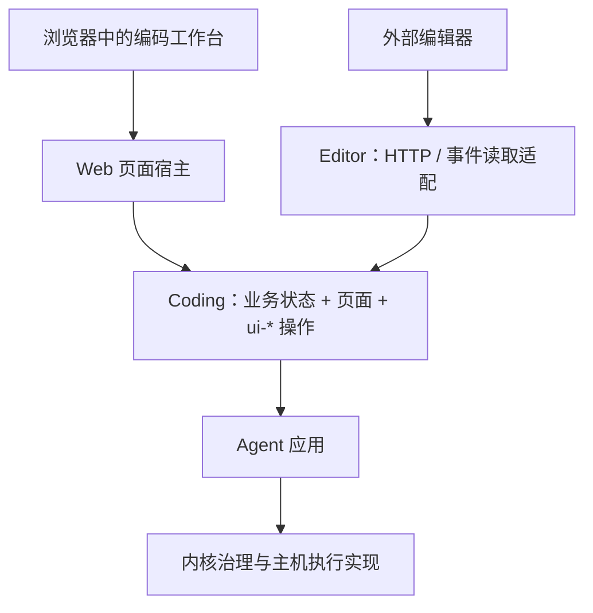
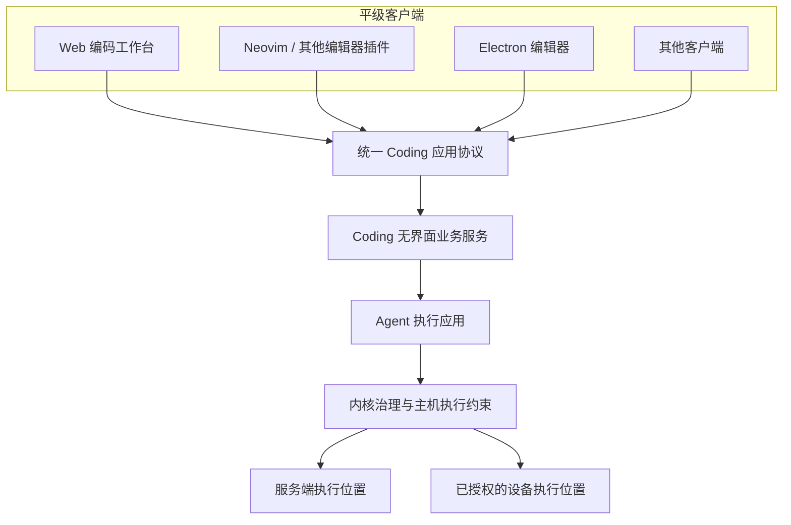

# Coding 与多客户端统一架构草案

> 2026-11-09 当前状态：本文涉及旧 Editor 应用的架构、安装、接口、源码保留和验收结果均属于当时记录，相关运行指引已过时。Editor 已退役并移除；仅 Mind、Remind 整应用暂停并保留源码。现行编码接入见[客户端协议](coding-peer-clients-protocol.md)和[实施记录](coding-peer-clients-implementation.md)，删除范围及待补验证见[Editor 退役记录](editor-retirement.md)。保留本文的其他架构与历史证据；原测试计数、产物散列及部署事实不改写，也不证明本次清理已验证或部署。

日期：2026-11-09。状态：规划草案，尚未开始 Coding / Editor 迁移。

本文回答：编码 Web 工作台、外部编辑器、未来 Electron 及其他客户端如何处于同一层；迁移时哪些职责应当保留、拆分或删除。依据当前源码静态核对，不代表暂停中的 Coding / Editor 已经能够运行。

## 1. 建议结论

采用一个无界面的 Coding 应用服务，多个平级客户端，以及共同的编码应用协议。

- Coding 拥有项目与对话的业务关系、每轮编码操作、业务命令回执和成果记录。
- Web 编码工作台、Neovim 插件、Electron 编辑器及其他客户端负责展示、输入和各自的交互状态。
- HTTP 接入复用 Editor 的可用实现，归入 Coding 应用边界；不再为“外部编辑器”保留一套特殊业务后端。
- Agent 提供执行能力；内核和主机实现继续执行真实身份、授权、预算、目录和实际停止检查。
- 执行设备与界面分开。一个 Electron 或 Neovim 进程可以同时带有执行设备组件，但两个角色必须独立授权、独立管理生命周期。

这次不增加内核命名空间，也不恢复 `projects.*`、`schedules.*`、全局内容读取或健康自报接口。Coding 的应用协议可以演进，不属于永久冻结的内核 API。

## 2. 当前实际架构

当前 Editor 已经较薄：`external/editor/protocol.ts` 把命令转为 `coding.*`；`external/editor/index.ts` 负责 HTTP 请求、协议版本和事件长轮询。它没有独立的编码任务数据库。

Coding 同时承载以下内容：

| 当前位置 | 当前职责 | 迁移归属 |
| --- | --- | --- |
| `external/coding/index.ts` | 模块工具、Web 页面登记、激活处理 | 拆成服务入口、HTTP 接入和 Web 客户端 |
| `page.ts`、`components.ts` | 编码工作台界面 | Web 客户端 |
| `workbench.ts` | 项目操作、会话操作和界面投影混合 | 业务操作留 Coding，界面投影移 Web 客户端 |
| `sessions.ts` | 项目绑定的持续对话、轮次、命令回执、共享 selected | 业务数据留 Coding；选中项改为客户端状态 |
| `work.ts`、`work-v2.ts` | 编码工作、依赖和执行对账 | Coding 业务层；不另建实际执行队列 |
| `agent.ts` | Coding 业务操作到 Agent 的映射 | Coding 的 Agent 适配层 |
| `results.ts`、相关成果读取 | 应用自己的成果记录和内容 | Coding |
| `external/editor/*` | 外部编辑器协议、HTTP、事件读取 | 共用接入层及必要的客户端协议代码 |

当前两条入口的能力也不完全一致：Web 的连续对话策略主要经 `workbenchCommand` / `applyConversationCommand` 实现，Editor 转发的是工作或执行操作，没有提供同等的持续对话入口；成果元数据的读取也不等于成果内容传输。因此仅让两端都调用 `coding.*`，仍不足以完成业务语义统一。

两点必须区分：

1. 外部编辑器界面与 Web 界面在概念上已经都是入口，但 Web 专用业务混在 Coding 里，协议也不统一，因此代码边界尚未体现平级关系。
2. Coding / Editor 目前仍处于暂停状态。Coding 激活还调用已经移除的 `projects.*`、`schedules.create`、`chrona.reportHealth`。保留源码不等于当前发布已经支持它们。

## 3. 目标结构

这里是职责分层，不是新增系统分类。产品仍只有内核和应用；客户端、协议和执行实现是应用内部的角色。

建议落地为：

| 单元 | 形式 | 负责什么 |
| --- | --- | --- |
| `coding` | 普通可安装应用 | 无界面业务服务、模块工具、Coding HTTP 接口 |
| `coding-web` | 普通可安装应用 | 登记 Web 页面、页面投影、必要的薄工具适配 |
| 外部编辑器插件 | 外部客户端 | 编辑器交互、连接配置、消费 Coding 协议 |
| Electron | 将来的外部客户端 | 桌面编辑体验、连接和凭据保管 |
| Coding 协议 / 客户端库 | 共享代码 | 请求响应 schema、错误和事件类型、传输封装 |
| Agent 与主机执行实现 | 现有执行边界 | Run、执行位置、目录授权、停止与成果捕获 |

`coding` 应在没有 Web、没有 `coding-web` 的情况下，仍能被已认证的外部客户端正常使用。卸载一个客户端，不应删除 Coding 对话，也不应停止其他客户端发起的工作。

`coding-web` 单独拆为应用，是为了明确安装和生命周期关系：需要 `coding` 与 `web`；`coding` 不反向依赖二者。当前 Web 页面只允许调用页面所属应用自己的工具，因此 `coding-web` 可以保留少量自己的页面读取、操作工具，再转调 Coding。这个限制不能通过取消页面身份或合同校验绕过。

平级不要求每个客户端必须使用完全相同的传输。Web 可以经过 Web 宿主的页面动作桥接，外部客户端使用 HTTP；两条路径必须汇合到同一批业务命令、校验和回执处理，不能各自实现“发送一轮”“停止”“接受结果”。

统一范围是 Chrona 的编码协作与 Agent 工作。编辑器自身的文本编辑、LSP、标签页和本地终端不需要全部搬进 Coding。未来 Electron 可以有完整编辑能力，也可以只是工作台外壳，这不影响它与其他客户端共享 Coding 服务；本草案不把 Coding 扩张成一个通用 IDE 后端。

## 4. 统一的是业务语义，而非一个任意命令入口

建议先按当前必要使用场景整理协议，再确定字段和工具数量。不要把现有 v1、v2、`ui-command` 所有分支原样合并成一个巨型公共合同。

必要能力分为以下几组：

| 能力 | 客户端需要的语义 |
| --- | --- |
| 项目 | 列出可用项目、经授权添加或创建项目、选择项目默认策略 |
| 对话 | 创建、列出、读取项目绑定的持续对话 |
| 编码轮次 | 提交用户输入、读取状态、回应问题、请求停止 |
| 事件 | 按游标读取事件，断线后补读；需要时读取完整快照 |
| 成果 | 读取本轮差异、成果元数据和应用拥有的内容 |
| 回执 | 用请求键查询一次命令是否已被接收，防止超时后重复执行 |

模块工具与 HTTP 接口共同调用业务处理函数。工具可以保留有类型的独立操作；HTTP 也应有明确 schema，不能允许客户端传任意 `agent.*` 或内核工具名来执行。

建议从一个当前应用协议版本开始迁移。旧 Editor 的双版本兼容分支没有保留义务。具体 URL、字段名和版本号在迁移设计中定稿，本草案不提前冻结。

共享协议代码应归 Coding 应用边界，不继续把所有编码业务类型塞进永久内核合同。若某些当前类型同时用于真实执行校验，必须先区分应用业务类型和可信执行类型，再移动，不能仅改变导入位置。

## 5. 数据归属与多客户端一致性

### 5.1 服务端唯一事实

Coding 持久化项目与对话关系、对话轮次、工作记录、命令回执、成果索引。Agent 和内核的执行记录是实际运行、停止与失败状态的依据。Coding 的业务状态不能覆盖真实执行事实。

概念上保持：一个项目可有多个持续对话，一个对话可包含多轮工作；执行重试需要可区分的 Run / attempt。不要把客户端连接、持续对话与一次 Run 合成同一个生命周期。

### 5.2 客户端自己的状态

当前 `sessions.ts` 的全局 `selected` 会导致 Web 切换会话影响另一个客户端。迁移后以下状态归客户端：

- 当前打开的项目、会话和文件。
- 标签页、滚动位置、展开项和正在编辑的草稿。
- 每个连接已经消费到的事件游标。

默认项目等确实需要跨客户端共享的偏好，由 Coding 显式管理。当前选中项不应隐式变成所有客户端的全局选中项。

### 5.3 命令与断线

- 需要副作用的命令使用稳定请求键；相同键、相同参数返回同一回执，参数变化返回冲突。
- Web 和编辑器同时发起写操作，由服务端按具体会话或工作执行并发控制。不能靠某个界面的按钮禁用保证正确性。
- 回应问题要绑定问题和实际执行身份，不能回应已经过期的一轮。
- 断开浏览器、关闭窗口或 detach 仅停止订阅；停止执行必须是明确命令。
- 请求停止与已实际停止分别表示。停止结果未知时，继续保留容量和目录占用约束。
- 事件读取允许重读、去重和恢复；若游标已不可用，要显式提示重新读取快照，不能悄悄丢失中间状态。

这次迁移优先复用已有事件来源与持久化证据，不引入第二套执行队列，也不为了统一客户端建立通用事件总线。

旧 `work-v2.ts` 中还包含依赖图、截止时间和周期对账。这些属于可选的 Coding 业务编排，不是多客户端接入的前提。建议第一批恢复持续对话与多轮执行；如果本轮确实保留依赖图，就必须明确完成事件、重启后的恢复和未确认状态对账如何驱动，不能把移除 `schedules.create` 后的“读页面时顺便刷新”宣称为可靠后台编排。真实执行超时仍由 Agent 和内核的硬限制实施。

## 6. 项目授权与执行位置

这是迁移的主要实质工作，不能用“替换几个接口名”解决。

当前主机项目注册实现仍保留在 `apps/server/src/config/execution-project-registry.ts`：它校验绝对路径、真实目录、访问权限、目录身份，并绑定执行主体。此前公开的 `projects.*` 已移除，Coding 没有可直接继续使用的公开项目入口。

目标是：

1. Coding 管理项目名称、默认项目策略和对话的项目绑定。
2. 主机可信实现确认真实目录与执行主体，产生不透明的项目引用。
3. Coding 经 Agent 应用的窄入口使用这些主机能力；具体新增或调整的 Agent 应用操作在迁移阶段定稿。
4. 可信回调必须恢复真实原始调用方，检查 workspace、当前应用身份、操作参数与授权范围；不能只看到 Agent 自身身份。
5. 执行启动时重新验证引用、目录身份和执行位置。Coding 写入自己的 JSON 文件不构成授权。

核对实现时应以当前独立 Agent 的真实调用链为准：`agent-delegation.ts` 保留原始调用应用的 moduleId / hash 来构造执行主体；另一个旧 `resolveExecutionPrincipal` 路径仍存在 `uses:["*"]` 转为 owner 的逻辑，不能据此假定新接入会自动共享 owner 的项目引用。项目授权和执行启动必须使用一致的主体绑定规则。

这不增加永久内核 `projects` 命名空间，也不把路径校验移给普通应用自行证明。

特别需要明确：Neovim 所在机器的 `/home/me/project`，与 Chrona 服务端的同名路径，可能是完全不同的目录。客户端只能选择服务端已经授权的项目引用，或经过设备执行位置的真实授权与映射流程。不能把远端编辑器传来的路径直接解释为服务端 cwd。

### 界面与设备两个角色

| 场景 | 界面角色 | 执行角色 |
| --- | --- | --- |
| 浏览器远程访问服务器 | Coding 客户端 | 服务器执行 |
| Neovim 连接服务器、只查看和发起工作 | Coding 客户端 | 服务器执行 |
| Neovim 希望在本机目录执行 | Coding 客户端 | 另需本机执行设备授权 |
| Electron 连接远端 Chrona | Coding 客户端 | 可选择服务器执行；本机执行需要独立组件与授权 |

不因某个进程有编辑器界面，就默认授予其设备执行权限。关闭界面也不能自动撤销仍在运行任务的执行证据。

## 7. 文件、成果与编辑器本地内容

项目文件保留在实际执行位置。Coding 拥有自己的成果索引、业务日志和成果内容访问接口；Agent / 主机负责可信捕获与来源绑定。

客户端通过 Coding 读取差异、成果和必要内容，不通过全局 `content.read`，也不直接读取 Coding 的存储目录。现有 `coding.read-result` 有应用自己的身份与 SHA256 校验读取器，可以作为共用成果读取的基础；HTTP 接入还需要补上相应传输，不能只提供一个客户端无法读取的内部引用。接受成果属于业务记录，不自动执行 Git commit、merge 或任意目录清理。

迁移第一阶段建议以已保存的项目文件作为编码输入。编辑器未保存缓冲区应当以后作为显式输入设计：绑定来源、版本和内容摘要。不要悄悄覆盖磁盘，也不要为 Electron 预先建立完整文件同步系统。

## 8. 接入、鉴权与安全边界

Coding HTTP 接口继续作为普通应用 listener，由现有服务器认证链保护。复用 Editor 的请求大小、严格解析、错误转换、长轮询中止处理等有效逻辑。

- `clientId` 只用于连接与偏好标识，不是授权凭证。
- 客户端不能通过请求体指定 owner、moduleId 或“已授权”。
- Web 页面经薄适配转调后，Coding 仍需依据路由记录的真实调用身份进行访问控制。
- 当前本地主人使用场景无需提前建立多用户 RBAC；共享一个主人凭据也不能声称提供了各插件独立权限隔离。
- Electron 将来必须独立处理凭据保管和 renderer / 主进程边界；本次不引入 Electron IPC 实现。

共同接入层使用 Coding 名称比 Editor 更准确。最终可以让 `coding` 应用同时提供模块工具和 `/api/coding` HTTP listener，移除旧 `editor` 服务应用。外部编辑器是客户端，并不要求 Chrona 服务端永远有一个同名应用。

## 9. 迁移顺序与验收

1. **收敛业务模型。** 选定一套当前必要的会话、轮次和成果语义，删除旧双版本适配；把界面选中态移出共享会话事实。首批以持续对话为主，依赖图编排单独决定是否恢复。
2. **完成项目与 Agent 接入。** 建立真实主机授权到项目引用的窄入口，保留预算、实际停止、未知结果与目录约束。
3. **恢复无界面 Coding。** 使用实际模块调用链和假 Pi，在没有 Web 的情况下验证创建项目、持续对话、多轮工作、回应问题、停止、成果读取与进程重启恢复。
4. **统一 HTTP 接入。** 迁移 Editor 的有效传输实现，严格鉴权、请求回执和事件游标；不恢复旧协议兼容。
5. **恢复 Web 客户端。** 拆出 `coding-web`，页面读取和动作薄适配调用同一业务层。验证 Web 与 HTTP 客户端操作同一会话，状态一致且界面选择互不干扰。
6. **解除暂停与发布。** 更新模块依赖、可用性、离线种子、资源、测试范围和说明；保留另外暂停应用的边界。只有实际通过验收后解除 Coding 暂停，旧 Editor 由新接入实现替代。

必须覆盖的场景：重复提交不重复执行；双客户端写冲突可解释；客户端离线后恢复；关闭界面不取消工作；旧问题回应被拒；停止未知不提前释放；未授权或被替换目录被拒；结果来源绑定；无 Web 的 HTTP 使用；卸载 Web 客户端不删除 Coding 业务数据。

本轮无需实现 Electron，也不修改仓库外的 Neovim 客户端。通过同一份协议与集成测试证明未来客户端可接入，之后再逐个迁移真实客户端。

## 10. 本次规划范围

本次只新增架构草案。没有修改 Coding / Editor 实现、解除暂停、运行模型、更新本地服务或更改仓库外客户端。

本建议的核心取舍是：先把共同后端和业务语义做清楚，再恢复两个现有入口；未来增加客户端主要是展示与接入工作，避免再次迁移编码业务和执行治理。
