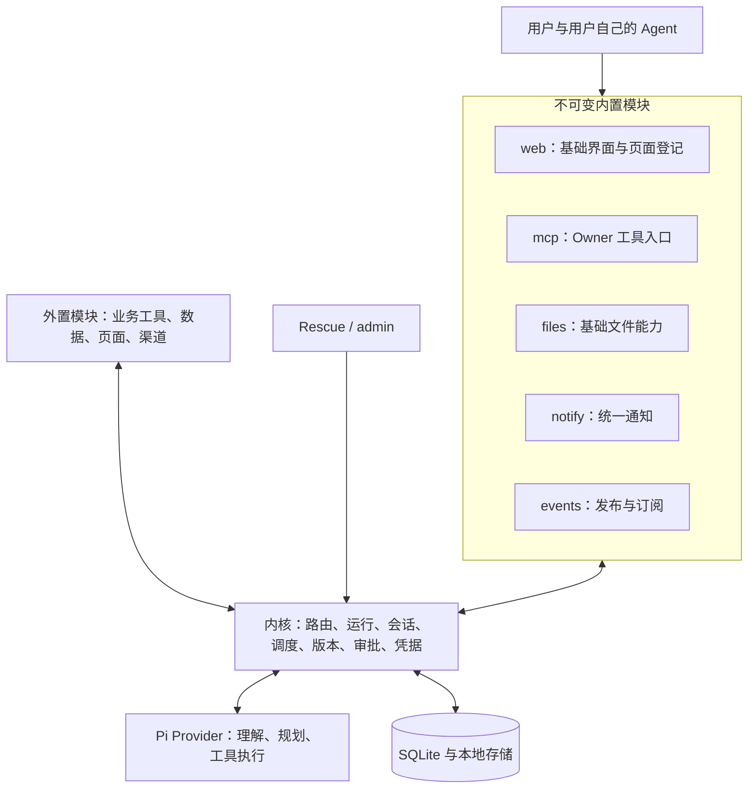
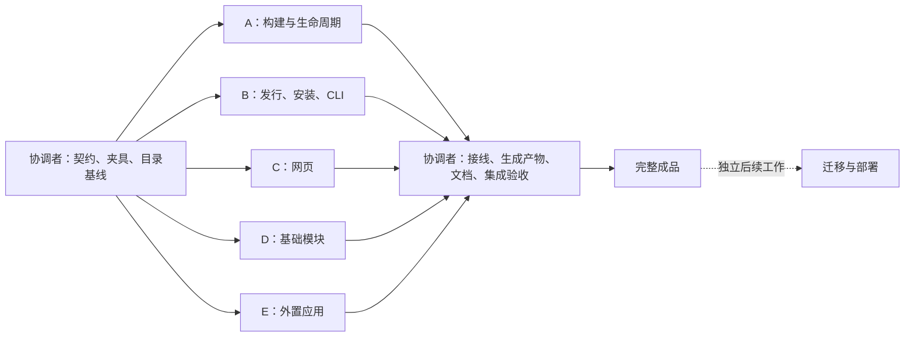

# Chrona 最小模块架构：整体实施方案与并行工作包

> 已由[统一开发方案](chrona-workbench-unified-development-plan.md)接替。后续实施、契约冻结与多 Agent 派工统一使用新文档；本文保留原设计背景，不再作为独立实施基线。

状态：原设计方案，尚未实现。本文描述目标成品，不代表当前架构或部署状态。用户已确定的方向是：内核、不可变内置模块、可变外置模块；通过扩展而非覆盖增加能力；直接完成最终结构，旧数据迁移独立处理。下文为合并前的方案记录，具体模块名单和接口设计以统一开发方案及协调者冻结的契约为准。

## 1. 目标与完成标准

Chrona 保留随用户需求生长的能力，但把运行时可修改的范围限定为外置模块。

- 内核提供运行、调用、会话、Agent、调度、凭据、审批、持久化和恢复机制。
- 内置模块提供最小且完整的公共功能，代码只能随 Chrona 发行版更新。
- 外置模块提供业务能力，通过工具调用和少量明确的登记接口使用、扩展公共功能。
- 不支持覆盖内置模块、同名替代、方法覆写、运行时补丁、插件优先级链或任意 before/after 钩子。
- 在全新数据目录中完成安装、对话、构建、使用、更新、停用、删除及恢复的闭环。
- 删除被替代的代码、契约、测试、提示词和文档；不保留双轨实现及过渡开关。
- 旧生产数据和历史定制版本的转换不是本次成品开发的依赖，也不得进入正常运行路径。

本次交付包含代码、测试、发行资源、CLI、网页和文档。方案编写不授权部署、操作真实数据或启动真实模型工作。

## 2. 目标结构

逻辑上只有三部分。Provider 是内核使用的执行适配器；当前 system/* 是内核接口的代码组织，不是第四种应用。内置与外置继续共用 SDK、事件协议、调用路由和 supervisor，不为分类再造两套运行时。

### 2.1 模块名单

| 归属 | 内容 | 说明 |
| --- | --- | --- |
| 内核 | chat、modules、schedules、provider、approvals、settings、secrets、activity、content、memory 转发及运行机制 | 不可被模块注册或替代 |
| 内置 | web、mcp、files、notify、events | 随发行版提供，动态构建不允许写入 |
| 外置 | qq、remind、mind、memory-local、其他业务应用 | 可独立安装、更新、修改、停用和按规则删除 |

QQ、提醒、主动跟进作为官方预装外置模块；memory-local 保持可选安装。外置可以随包分发源码，但不因此获得内置身份。新建工作区完成一次明确的初始化后，普通启动不重复预装；用户删掉的模块不因重启或 Chrona 升级自动复活。

### 2.2 保留的基础设施

保留 Pi RPC、统一 routed calls、SDK 独立进程、当前 SQLite 持久化方式、数据与内容私有目录、事件投递、审批、预算、外置版本 hash、构建检查、数据连续性、备份与受限恢复。保持默认 trusted-local 和显式 required-isolation 的现有含义。

本次不顺带重写队列、合并所有状态机、更换 UI 框架、增加通用插件框架或新 Agent loop。接口约束仍不声称提供同 OS 用户下的恶意代码隔离。

## 3. 模块身份与生命周期契约

### 3.1 身份只有一个权威来源

- 保留 Module.builtin 作为模块类别字段，不另加一套重复分类；true 表示内置，false 表示外置。
- ModuleVersion.source 仅记录提交来源，不用于猜测模块类别，不允许据此改变类别。
- 内核接口名和发行目录内的内置模块名组成保留名称集合；即使尚未初始化数据库，也拒绝外置占用。
- manifest 不提供可自授的 builtin 字段；发行注册器从可信发行目录确定身份。
- 对外投影统一给出 origin（kernel/builtin/external）与 capabilities（可配置、构建、回滚、停用、恢复、删除等实际动作）。字段精确结构由协调者在共享契约中冻结；所有界面消费同一投影，不自行推测。
- 所有 mutation 使用共同的身份/生命周期校验，投影不代替执行时检查。

### 3.2 操作矩阵

| 操作 | 内核 | 内置模块 | 外置模块 |
| --- | --- | --- | --- |
| 查看接口、状态与诊断 | 支持 | 支持 | 支持 |
| 修改声明配置/业务数据 | 按接口 | 支持 | 支持 |
| Agent 构建/提交代码 | 拒绝 | 拒绝 | 支持 |
| 用户模块版本回滚 | 不适用 | 拒绝 | 按现有数据安全规则 |
| 任意同名代码替换 | 拒绝 | 拒绝 | 仅同一外置模块的受检更新 |
| 暂停/恢复 | 不适用 | 保留运维操作，救援入口独立 | 支持 |
| 应用删除 | 拒绝 | 拒绝 | 明确确认、备份、检查依赖和入口关联 |
| 代码升级 | Chrona 发版 | Chrona 发版 | 显式安装/构建/更新 |

不可变指代码，不限制设置或业务数据。内置暂停不是卸载；数据与发行身份仍保留。不能因“只有内置不可删除”而让有活动会话/入口关联的外置模块被直接删除；外置入口先停用并明确处置关联，再执行删除。首版允许返回可操作的冲突，不自动丢弃会话。

### 3.3 必须覆盖的后端入口

普通 build、build-owner、propose、多模块 request-group、直接激活、rollback、审批后继续执行、admin build 和发行注册都使用同一身份规则。构建排队前及最终提交/激活前分别校验，拒绝应在生成可用候选或产生业务副作用前生效。不能只隐藏工具或靠提示词约束。

读取内置源码和接口作参考可保留；checkout 不赋予原名提交权限。内置旧候选和手工伪造来源不能通过批准、组更新或 CLI 绕过。

## 4. 发行与安装的最终行为

### 4.1 内置模块与 Chrona 发行版绑定

- 发行资源带内置模块名单、manifest、内容 hash 和发行版本关联；采用最小静态目录，不建设远程市场或签名基础设施。
- 内置源码测试、类型检查和资源完整性检查进入发行构建。启动仍检查资源完整性、本机依赖是否可用及数据 schema 是否兼容。
- 内置资源注册不再伪装为用户/Agent 提案，不经过外置构建排队、提交次数或普通候选审批卡。
- 可以复用版本元数据和内容 store，但内置可启动代码必须属于当前发行目录；不能激活任意历史定制 hash。
- 内置应用自身的数据升级依旧可能需要备份和确认。此项是新产品未来正常升级的职责，与旧系统迁移无关。
- 当前发行代码无法安全使用既有数据时，模块标明需处理并停止接收业务事件，保留 rescue/admin；不悄悄启动旧发行代码。
- 内置进程可以退避重启和暂停，不运行外置模块的自动代码回滚规则。内置恢复使用当前发行资源，软件降级是整版运维操作，不能跳过数据兼容检查。

### 4.2 外置模块安装与更新

- 官方预装包和用户/Agent 构建最终进入同一外置检查与激活路径。
- 预装初始化状态持久化；中断可继续，但已完成后重启不重装。利用现有存储，避免额外安装数据库。
- “代码已安装”与“已配置可运行”分开：QQ 未填凭据应明确等待配置，不循环启动失败；memory-local 仅在选择安装时处理依赖。
- 发行包升级不会自动更新、覆盖或重新安装外置模块。更新必须明确选择；用户已有定制不能被官方包静默替换。
- 首版只需支持随包资源和本地目录安装。新增最小 modules.install 系统接口及 chrona admin install <name> 入口，供网页/MCP/CLI 共用；可选内置包来源由服务端名单解析，不能任意读取宿主路径。
- 本地源码继续用现有 propose；不增加第二种外置更新算法。
- 执行耗时检查时不能阻塞基础入口服务或 tick。初始化、安装失败可查看诊断并显式重试。

## 5. 扩展边界

统一使用现有 chrona.call 和 callback。无需新增扩展引擎。

| 基础功能 | 内置职责 | 外置职责/接口 |
| --- | --- | --- |
| web | 认证后基础界面、系统页、导航、共享渲染器、通用工具页 | web.page-set/page-remove，业务数据与动作留在模块 |
| notify | 通知队列、安静时段、预算、摘要、送达状态 | notify.send；渠道登记自己的投递工具 |
| files | 文件读写、版本、移动、删除/恢复 | 分类、整理、转换、生成内容，通过 files 工具组合 |
| events | 声明校验、订阅、异步扇出 | 发布业务事件，登记自己的订阅回调 |
| mcp | 认证后的 owner 工具发现与调用 | 新增工具按 visibility 暴露，不改 mcp 专属路由 |
| memory 内核接口 | 按配置转发 retain/recall/forget | 外置实现声明 contributes.memory |
| schedules 内核接口 | 持久化日程与事件投递 | remind 等应用创建、取消自己的定时器 |

登记生命周期要求：

1. 身份来自真实调用方，回调归属校验由内置模块执行。
2. 同一个应用重复 activated/登记不产生重复页面、渠道、订阅。
3. 停用时停止相关执行并隐藏或标明不可用，不改写业务成功状态。
4. 删除时清理登记；重新启用时可幂等登记。
5. 更新和回滚后校验新版本工具契约，过时引用明确失效，不能调用其他应用顶替。
6. 不共享私有数据目录；页面登记不复制业务数据库；路由结果未知时不偷偷换实现重试。

具体业务做不到时，优先修改外置应用。确实需要新公共能力时，作为 Chrona 本体开发发版；不开放任意注入点。

## 6. Agent、网页与运维体验

### 6.1 Agent

统一指引：调用已有能力 → 修改允许的配置 → 新建或修改外置应用 → 基础接口不足时明确报告需修改 Chrona。

工具目录呈现模块类别和可用动作；构建拒绝要说明不可修改的目标和可用扩展方式。普通会话和构建会话均遵守，不恢复旧的隔离工具清单。

清理主提示词中“任何行为都可以通过改对应模块实现”的承诺。tick.ts 当前直接点名 mind 的工作协议需删除，改为启用能力提供的描述/上下文；外置模块缺席时不要求调用其工具。不新增按名字分派的业务规则。保留 owner 有界构建的单次授权和预算语义。

### 6.2 网页

- 显示“内置/外置”，系统接口在技术视图中标为内核。
- 内置页展示配置、状态、诊断和允许的运维动作，不展示构建、代码回滚、删除。
- 外置页展示构建、版本、配置和按 capabilities 开放的生命周期动作。
- 提供最小的官方外置模块安装入口，展示未安装、检查中、待配置、可用、失败状态。
- 后端拒绝时展示明确原因，不依赖按钮隐藏保证不可变。
- 所有页面继续共用 json-render，不能新增第二套手写页面。

### 6.3 运维

Rescue 和 admin 独立于应用健康。删除“回滚到 builtin 以丢弃定制”的旧语义；保留外置版本回滚和当前发行模块的重启/诊断。内置升级随整体发行操作；备份依旧覆盖数据库、应用数据、会话和凭据。

## 7. 源码改动与删除清单

以下为已核对的入口与预计影响，不是允许多个 worker 同时编辑的文件名单。

| 当前位置 | 最终变化 |
| --- | --- |
| module-builtin.ts | 改为发行资源登记，删除 preserveCustomization 和定制保护审批清理 |
| module-proposal.ts / module-build*.ts | 只允许动态构建外置；删除内置候选特殊路径 |
| module-activation.ts / module-generation.ts / module-supervisor.ts | 区分发行绑定启动与外置版本激活，统一运行协议 |
| module-remove.ts / module-status.ts / modules.ts | 生命周期以身份规则判断，删除旧内置定制语义 |
| system/modules.ts / module-overview.ts / system-apps.ts / system-outputs.ts | 统一身份、能力投影、安装接口与工具入口 |
| tick.ts / module-build-session.ts / module-reference.ts | Agent 指令与工具边界；初始化不再每次 tick 导入发行候选 |
| builtin/web、notify、events、files、mcp | 缩小职责、保留现有扩展接口、补齐登记生命周期 |
| builtin/qq、remind、mind、memory-local | 移到 external/ 同级目录，运行名保持不变 |
| apps/server/src/steward-runtime.ts / ports.ts | 注入可信发行与外置预装资源，装配新的初始化流程 |
| packages/cli/src/admin*.ts | 安装与新恢复语义；删除 builtin 特殊回滚 |
| scripts/build-binaries.ts / 发行脚本 | 分别打包内置资源与官方外置包，包含可重建的发行目录 |
| prisma/schema.prisma / 0001_initial | 仅按新目标模型需要修改；无旧数据迁移链 |

最终没有 custom-builtin 状态，没有 builtin 来源与非 builtin 活跃版本混用，没有启动时重新覆盖外置，没有旧模式兼容开关。

## 8. 并行实施方式

### 8.1 P0：协调者先完成契约与基线

协调者先做一个可编译的共享基线，供所有 worker 从同一版本出发。它是并行接口基线，不是可发布的半成品。

协调者独占：

- packages/contracts/src/steward/index.ts 及相关共享 schema；仓库规则禁止 worker 直接修改此文件。
- prisma/schema.prisma、prisma/migrations/0001_initial、DB 生成接线。
- ports.ts、system/modules.ts、system-outputs.ts、module-overview.ts、system-apps.ts。
- modules.ts 公共 facade、tick.ts、主提示词、module-reference.ts、公共导出与服务装配。
- scripts/build-binaries.ts、打包和工作流、根 package 配置及锁文件。
- AGENTS.md、当前架构/操作文档、本文及最终集成测试。

P0 必须产出：

1. 确定内置名单、保留名称、origin/capabilities、错误码和安装请求/结果 schema。
2. 最小共用 identity helper，负责身份分类与操作矩阵；函数签名先落地，后续变更由协调者处理。
3. 发行目录与资源路径类型；内置和预装外置的目录布局。
4. 安装/初始化状态存储位置与状态转换，不给每个 worker 自建状态表。
5. A/B 使用的明确接口：resolveBuiltinRelease、installExternal、ensureWorkspaceInitialized 及既有 facade 的绑定方式；最终签名写入接口清单。
6. 公共测试夹具：最小内置、最小外置、预装包、伪造身份、失败安装；worker 测试在各自命名空间，不互改公共夹具。
7. 将四个外置目录一次移动到 external/ 并修正必要引用，避免 worker 边搬目录边互相修改。
8. 记录现有未提交改动基线。工作区 web/system/modules.ts 已有用户改动，另有 agent-workbench-execution-design.md 和 module-lifecycle.bun.test.ts；保留其内容和意图，不覆盖、不认领、不自动提交。

接口冻结后，五个工作包可以并行。

### 8.2 工作包 A：外置构建与运行生命周期

**目标：** 所有可变代码路径只处理外置模块，内置启动绑定发行资源。

**允许文件：** module-proposal.ts、module-build.ts、module-build-session.ts、module-activation.ts、module-generation.ts、module-supervisor.ts、module-remove.ts、module-status.ts，以及协调者分配的对应辅助实现和同目录测试。共享 facade 不在本包。

**任务：**

- 构建入口及最终提交/激活双重身份检查；包含 group、owner build 和审批恢复路径。
- 删除内置定制及候选特殊分支，内置不得通过旧 hash 激活。
- 接入 B 提供的发行解析器；supervisor 继续共用进程协议。
- 自动代码回滚仅适用外置；内置故障仍有重启、暂停、诊断。
- 外置删除处理依赖和入口关联；不得自动删除会话。
- 构建提示词只承诺外置修改；与协调者主提示词保持一致。

**验收：** 表驱动覆盖操作矩阵，绕过路径均拒绝；正常外置构建/更新/回滚/故障恢复仍工作；不重放结果未知动作。

### 8.3 工作包 B：发行登记、预装与 CLI

**目标：** 内置随发行运行，外置有一次性初始化及显式安装。

**允许文件：** module-builtin.ts、发行解析/安装/初始化的新实现文件、packages/cli/src/admin.ts、admin-build.ts 及必要 CLI 局部文件和测试。ports、主 runtime、打包脚本归协调者。

**任务：**

- 实现发行解析、资源完整性和名称保留校验。
- 删除 preserveCustomization，不再借用外置 propose 导入内置。
- 实现预装一次完成语义、安装失败/中断恢复及显式重试。
- 官方外置安装调用 A 的同一检查与激活路径，不复制构建算法。
- 实现 admin install，删除 admin rollback <name> builtin。
- 输出需要协调者接入的装配/打包清单和接口调用示例。

**验收：** 首次初始化、重启、删后重启、包升级、同名冲突、缺依赖、需配置均有测试；不触发真实 QQ/模型。

### 8.4 工作包 C：网页与扩展页面

**目标：** 界面完整呈现三部分模型，业务页面通过登记扩展。

**允许文件：** builtin/web/** 的源码与测试。共享输出 schema 归协调者；pages.js 等生成产物由协调者最终统一构建，本包不手改。

**任务：**

- 使用统一 origin/capabilities 展示应用与操作。
- 内置页删除构建、代码回滚、删除入口，保留配置和诊断。
- 外置安装和生命周期的完整状态体验。
- 页面登记对停用、删除、工具变化和恢复处理正确。
- 保留已有用户修改的行为；有冲突提交具体差异给协调者，不整体覆盖。

**验收：** 用户可见状态/动作测试；空、加载、失败、待配置、运行中、完成；1440×900、1024×768、390×844 实际浏览器验证，无横向溢出。

### 8.5 工作包 D：公共内置模块与登记生命周期

**目标：** notify、events、files、mcp 职责稳定且不认识业务模块。

**允许文件：** builtin/notify/**、builtin/events/**、builtin/files/**、builtin/mcp/** 及其测试。web 归 C；内核 memory.ts、system/* 归协调者。

**任务：**

- 检查并删除具体业务名单/依赖，保留通用调用和明确登记。
- 渠道与订阅归属、幂等、停用、删除、更新后的引用校验。
- MCP 使用共享工具目录，正确暴露安装和可操作动作，不绕过身份规则。
- files 只提供基础文件能力，不增加整理或研究业务。

**验收：** 用两个虚拟外置模块完成独立登记；停用一个不影响另一个；失败和未知结果不触发重复投递；无真实外部发送。

### 8.6 工作包 E：官方外置应用

**目标：** qq、remind、mind、memory-local 在没有内置特权时完整工作。

**允许文件：** P0 移动后的 external/qq/**、external/remind/**、external/mind/**、external/memory-local/** 及对应测试。

**任务：**

- 使用公开内核/内置工具，删除内置身份假设。
- QQ 作为可选入口及通知渠道，缺凭据为待配置；保留正确会话与回复归属。
- remind 仅组合 schedules 与 notify。
- mind 自带工作协议和数据，不要求内核按名字插入指令。
- memory-local 显式安装和配置后工作，缺席不阻断会话。
- 登记自己的页面，支持反复启用和版本更新。

**验收：** 每个模块能独立安装、配置、运行、暂停和重新启用；不借助内置名单特例；测试 fake kernel，无真实模型/QQ。

### 8.7 集成职责与依赖图

A/B 存在运行时调用依赖，但以冻结接口和测试替身并行开发。C/D/E 使用冻结工具契约；任何共享接口变更由协调者一次修改并通知消费者。不能各自在工作区复制接口、加入临时 fallback 或等到合并时解决语义分歧。

五个 worker 是最大合理拆分；资源有限可合并 D/E。构建、测试等重任务仍按机器内存预算串行调度，代码并行不等于同时跑全量测试。

## 9. 派工与交付协议

每个 worker 收到：目标、允许文件、禁止文件、冻结接口版本、验收场景、现有改动说明。新文件必须归入自己的子系统，跨边界变更先报协调者。

- 独立 Orca worktree；本方案不自动启动 worker。
- 委托与终端遵循 orca-cli/orchestration skill，长命令使用任务终端。
- worker 先跑本包有意义的针对性测试；协调者统一运行全量检查和生成产物。
- 不提交或推送，除非用户另行授权；可以用工作树 diff/patch 交付，协调者审查后整合。
- 交付必须列出文件、行为变化、实际执行的检查与结果、未解决事项、需要协调者接线的接口。
- “代码写完”“测试待跑”“界面未验证”不算通过验收。
- 不操作生产实例、不读凭据、不使用真实账号测试、不自动迁移数据。

## 10. 最终验收矩阵

| 场景 | 必须观察到的结果 |
| --- | --- |
| 全新目录启动 | 基础入口可用，内置版本绑定发行；预装状态可见 |
| 无 QQ 凭据/无 memory-local | 明确待配置/未安装，不阻断基础对话与工具 |
| Agent 修改内置 | build/propose/group/owner/admin 各路径一致拒绝 |
| 抢占保留名称 | 初始化前后都拒绝，无可激活候选残留 |
| 外置扩展 | 不改内置源码即可登记页面、渠道、事件并使用文件/调度 |
| 安装更新外置 | 检查、启用、数据保护、诊断完整，来源不改变身份 |
| 停用/删除/恢复 | 工具、页面、渠道、订阅、日程状态一致；删除有确认与备份 |
| Chrona 升级 | 内置更新，外置用户版本不变，已删除预装模块不复活 |
| 外置更新启动失败 | 符合条件时一次回滚；未知结果不重放 |
| 内置启动失败 | 有诊断与救援，不切到用户候选或任意旧代码 |
| 重启中断安装 | 不重复产生安装效果，可明确继续或重试 |
| 无 mind | 主提示词不要求不存在的工具，普通会话仍正常 |
| 资源打包 | 二进制/发行包可找到两类资源，不依赖源码树路径 |

检查按针对性 → typecheck/lint → test:bun/test:api → 发行 smoke → 浏览器完成；重任务逐个、内存受限。生产外部服务用替身。检查失败必须定位修复，不能用删除断言或跳过测试掩盖。

## 11. 文档与删除验收

协调者同步 AGENTS.md、architecture.md、steward-goals.md 中受影响边界、operations.md、module-dependency-direction.md、模块恢复和 owner bounded build 文档；历史记录保留历史属性，不批量改写过去。

搜索并逐项审查 preserveCustomization、customized built-in、rollback builtin、内置普通提案、内置定制审批、提示词中修改基础模块等残留。允许历史文档和明确拒绝旧行为的回归测试出现旧词，不允许生产逻辑仍提供旧模式。

最终文档必须说明：三部分归属、内置随发行更新、外置安装/更新、扩展方法、数据兼容与救援方式。不能把模块数量减少当作完成，必须通过上述使用闭环。

## 12. 迁移边界

旧部署不参与本次开发验收，不新增为旧状态服务的兼容字段、运行分支或迁移开关。新成品仍应保留正常的未来应用数据升级能力。

成品完成后，另行盘点旧模块、定制源码、数据与关联，编写一次性转换工具，在副本演练，经明确授权再部署。遇到无法转换的定制，单独解决，不反向修改新架构的职责边界。

## 13. 依据与当前状态

本方案基于本次用户明确的架构方向，以及已读取的当前 architecture.md、module-dependency-direction.md、security-simplification.md 和 module-builtin.ts、module-proposal.ts、module-build-session.ts、module-build.ts、module-remove.ts、tick.ts、schema.prisma、模块 manifest。

> 🧠 **From Hindsight memory (Key decisions and rationale)** — Chrona 管理持久状态与控制机制，Provider 提供推理及原生工具执行；这一职责边界继续保留，已对照运行时组装与当前实现文档核对。

本文仅新增设计文档，没有实现代码、启动 worker、执行迁移或部署。实施开始前由协调者建立 P0，不以当前工作区已有修改为可随意覆盖的基线。
