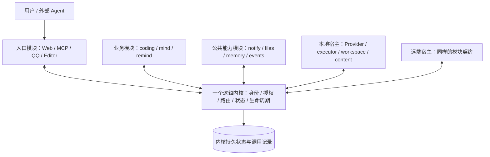

# 统一模块协议与本地／远端宿主：开发实施方案

日期：2026-11-07。状态：**V1 本机统一实现、最终审查与隔离真实模型验收完成；未部署**。最终证据见[本机 V1 验收](./unified-module-v1-acceptance.md)。远端通用宿主属于后续版本，不是 V1 交付条件。
核查基线：`platform-v2` / `31a726c9c1dc58a7a989a6beca57d573c59d7629`，文档修改前工作树干净。

本文是后续架构开发入口，接替此前把 Provider、执行后端、存储适配器作为独立对外调用类别的目标设计。[当前架构](architecture.md)继续描述现有实现；[M1–M3 方案](chrona-workbench-unified-development-plan.md)、冻结的 P0/P1/P2 契约和各阶段验收记录保留历史与兼容依据；[Provider 分离计划](provider-kernel-module-plan.md)记录已完成的边界收窄。本文不表示通用远端模块已实现，不修改既有验收结果。

用户已授权本机协议、执行接线和文件边界的实现，允许重构期间暂时不可用；不要求维持中间版本或引入兼容桥。由当前 Agent 亲自实现，不派 worker。连接真实设备、迁移用户数据和生产部署不在本次授权内。后续收口明确授权使用已配置模型完成隔离真实验收，以及提交、推送本机 V1；模型调用不扩大到其他私人账户操作。

## 1. 目标：一个内核，一种模块模型，一套调用协议

内核之外的 Chrona 能力都以模块契约接入：入口、业务、通知、记忆、Provider、执行器、工作目录和内容存储。模块之间统一使用 `chrona.call` 与同一套结果／回调机制，全部经过内核治理；位置和底层传输不改变业务调用方式。适配器可留在模块内部，不再成为调用者必须学习的另一层 API。

部署和权限是独立属性：同一协议可连接本地或远端宿主，不意味着同等权限、任意代码均可信、统一动态更新权限或自动部署到任意主机。现有 builtin 发行身份、工具 visibility、凭据声明和 owner 授权继续有效；`uses` 仍是契约，不改成运行时许可名单。

入口向用户提供 HTTP、MCP 或编辑器协议，模块内部访问模型、磁盘或服务商仍使用相应原生协议。统一的是 Chrona 模块边界，不要求外部服务改用 Chrona 协议，不要求内核内部函数也做 RPC。

## 2. 内核与模块的责任边界

| 责任 | 内核 | 模块／宿主 |
| --- | --- | --- |
| 身份与来源 | owner、模块、激活版本、宿主绑定、撤权；验证来源与契约 | 以宿主授予的绑定连接，不自行声明其他 caller |
| 调用 | 路由、受众、参数／输出、固定目标、幂等、持久回执与恢复 | 实现工具，处理投递和回调 |
| 运行 | 唯一 Run 队列、预算、deadline、租约、取消、资源占用、状态提交 | 执行点落实约束，报告启动／进度／退出证据 |
| 业务 | 不持有具体业务策略 | 工作目标、依赖、位置选择、记忆策略、通知、文件整理、成果接受 |
| 文件 | 归属、授权、引用绑定、摘要与版本、释放／删除条件 | 具体字节 I/O、目录准备、Git worktree、捕获及清理 |
| 演化与恢复 | 检查准入、原子激活、批准绑定、数据一致性、故障策略 | 受检代码、私有数据、宿主准备及事实回执 |
| 启动根 | 启动配置、可信宿主加载、数据库、调用日志、最小恢复入口 | 被加载的能力实现，不参与批准自身 |

系统模块继续是内核机制的路由门面，不把它们全部搬成普通进程。内核需能在 Provider、内容存储或远端宿主不可用时启动、保存未知状态、撤权和恢复。内核数据库、启动身份及最小恢复状态不依赖尚未启动的模块；数据库层保持内部实现，不为了统一而新增数据库 RPC。

模块代码来源、发行方式、运行位置、所需宿主能力分开建模。Provider 或执行模块需要受信任安装与宿主绑定；一个普通提案不能因此取得进程启动、任意路径或全局秘密权限。同用户 `trusted-local` 的 OS 风险边界仍然存在，网络认证也不等于恶意代码隔离。

## 3. 重构前基线与差距

路径简写：`steward/` = `packages/engine/src/modules/steward/`。

| 区域 | 基线实际实现与证据 | 所需修改 |
| --- | --- | --- |
| 统一调用基础 | `steward/module-calls.ts` 已统一系统／应用工具；SDK 有 sync/async、key、callStatus、call_result、expectedTarget | 扩展现有契约与投递边界，不创建第二个 RPC 总线或工作队列；保留目标身份和未知结果规则 |
| 模块宿主 | `module-supervisor.ts` 创建本地数据目录、socket 并调用 sandbox.startModule；SDK `module-sdk/sdk.ts` 直连 Unix socket，事件串行，断线拒绝 pending | 从模块语义分离宿主启动和传输实现；增加明确绑定的远端宿主，以及断线／重连对账；本地仍用现有 socket |
| Provider | `contracts/.../index.ts` 的 ProviderAdapter 返回带 inject/abort/done 的进程内 handle；`apps/server/src/steward-runtime.ts` 直接组装 Pi | 将非序列化 handle 转成固定操作引用与工具／事件；Pi RPC 留模块内部；服务端、设备、普通会话、构建和 admin 路径都纳入 |
| 执行后端 | `ports.ts`、`execution-device-runtime.ts` 使用专用 controller/admission/remoteCompletion；设备 daemon 已有 poll/report/reconcile、journal/fence | 复用现有身份／证据语义，收敛到宿主投递协议；通用宿主不能直接持有 Prisma 事务或修改 Run；设备协议仍是当前有效路径 |
| 工作目录 | `execution-projects.ts` 为 owner 位置映射；`execution-server-workspace.ts` 在授权后调用本地 Git／目录准备 | 把目录准备、捕获和清理实现放模块；路径留在所属宿主，返回身份与收据；授权映射与占用权威仍归内核 |
| 内容存储 | `steward/content.ts` 直接 realpath/stat/readFile；聊天附件有独立读取路径；files 是用户文件应用 | 增加内容模块契约，统一附件／成果的引用、摘要、大小、读写回执；files 调用它，不接管整个平台存储 |
| 平台数据 | `module-data.ts`、版本／迁移／备份代码直接使用本地目录；SQLite 和文件共同恢复 | 首轮保留内核启动、版本与迁移基础；业务文件逐项脱离宿主路径假设。平台快照后端外移须单独证明恢复一致性，不并入通用内容上传 |
| HTTP 与页面 | manifest listen、模块 HTTP 代理和内容路由依赖本地进程／目录 | 首个远端只支持无 HTTP 入口的能力模块；远端 listen、SSE、文件代理须另有明确契约与限额，不能默认为自动支持 |
| 安装与更新 | 本地离线检查、代码 hash、activation、数据副本、发行种子已有机制 | 增加宿主兼容检查、准确制品绑定与准备／激活回执；远端不可用时不宣称启用成功，不跨机器照搬本地 rename／迁移原子性 |
| 隐私与可观测性 | system unrecorded 工具对凭据／模型正文不落调用记录；活动／历史有脱敏与上限 | 统一协议不得把敏感参数强制写入 Invocation；保存操作元数据，秘密使用受作用域短期交付；进度、成果就绪、人工接受保持分离 |

结论：现有路由和专用设备恢复机制可复用，但当前通用模块不能简单修改一个 URL 就远端运行。Provider 模块化、跨宿主文件语义、统一恢复和远端安装均有真实缺口。

## 4. 统一协议需要明确的语义

本节冻结行为要求；具体字段、工具名和 schema 尚未冻结。`executor.start`、`workspace.prepare`、`content.put` 等是职责示例，不是现有公开接口承诺。

### 4.1 身份、目标与交付

- 内核派生真实 caller，禁止远端消息体自报 owner／kernel。保留 workspace、moduleId、版本／activation、contractHash；在信任绑定中增加 host／instance 及撤销代际，拒绝旧连接和旧世代回执。
- 名称用于解析；首次送达前固定目标及契约。重装、升级或部署更改不能让未知操作改投另一实例；迁移须显式处理仍在途的调用。
- 传输帧有界、有版本、有认证与机密性保护；具体传输方式和配对协议在契约阶段选择，复用设备机制中已验证的设计，不能直接扩大旧 executor 凭据。
- 本机和远端使用相同逻辑信封与错误语义；进程内优化也必须通过同等检查。内部 DB 事务不跨网络传递，不在 writer transaction 中等待远端 I/O。

### 4.2 短调用、长操作与取消

- 短调用返回受检结果。长操作立即返回固定操作引用，使用同一套回执／事件／状态查询；稳定绑定原调用和 Run/attempt，不复制业务工作状态。
- 调用接收、操作启动、最终结果、实际停止是不同事实。等待超时不等于取消，租约失效或断线不等于进程已停。
- 取消与问答控制不能排在正在等待完成的同一模块串行事件后面。长操作入口不得占住 SDK handler 直到结束；定义有界控制投递和结果通路，复用现有机制，不另起业务执行循环。
- 保留原工具 key 和目标绑定；长操作接收回执不能被现有 Invocation succeeded 误读为业务成功。先决定复用哪些表／事件及缺少哪些字段，再按迁移政策实施，不先建通用 operation 数据库。
- 远端模块可以发起其他模块调用，但仍回到内核，继承原调用预算、deadline、深度与循环检测。大文件通过受控内容传输，不能塞入无限 JSON 事件。

### 4.3 断线与恢复

| 事实 | 行为 |
| --- | --- |
| 能证明未送达 | 在原身份及有效期限内按契约重投 |
| 已接收，最终回执缺失 | 用原调用／操作 ID 向原实例对账；保留未知，不盲目重做 |
| 重复请求或最终回执 | 返回原结果，校验摘要和身份；不能产生第二次副作用 |
| 取消已请求，停止未证实 | 撤销能力，保留必要占用；继续收取原身份的停止／最终回执 |
| 旧实例、旧授权或旧 activation 报告 | 拒绝新启动与新权限；只有显式受限的原操作 final drain 才可接收 |
| 宿主丢失 journal 或无法证实停止 | 保留未知与诊断；人工处理，不自动迁移／重跑 |

不承诺任意外部副作用 exactly-once。对账窗口、journal 保留期限、事件序号／ACK、缺口、上限、背压与过期回执处理必须在契约中定义；超过恢复窗口不能把未知改成成功或未执行。

### 4.4 工作目录与内容

- 远端路径属于远端宿主；服务器不 stat/read 设备路径，不把任意 URL 或绝对路径当可信内容引用。
- 内容引用绑定 workspace、所属模块、存储实例、不可变版本／摘要和大小；授权在读取时重核。上传中、存储确认、内核引用提交分别记录，失败留下可对账状态。
- 传输使用有界、可校验的通道；短期凭据绑定接收者和用途，不复制 API_KEY、run token 或 Provider profile。重试不得覆写既有不可变成果。
- 清理验证所有权、占用、实际停止、dirty、保护选择与集成关系；远端删除结果未知时不换 key 重删。内容 GC 与工作树删除分别治理。
- 本地模块自己的私有 data/content 目录可保留；远端宿主提供其本地目录。跨模块访问使用工具或内容引用，不共享绝对路径。远端离线测试不能读取生产私有数据。

## 5. 最小实施阶段

V1 覆盖 U0 的本机契约、U1、U2 与本机交付检查。U3 及 U4 的远端设备协议收敛留到后续版本。表中退出条件是验收要求，不表示已经完成。

| 阶段 | 交付与主要修改区 | 退出条件 |
| --- | --- | --- |
| U0：契约和清单 | contracts、SDK、module-calls、ports 的边界清单；冻结 host/instance、操作引用、敏感数据、恢复、信任与更新规则；列出 schema/认证兼容影响 | 覆盖普通会话、complete、构建/admin、编码、取消、附件、恢复；无命名／状态歧义，明确需要何种实现授权 |
| U1：先统一本地调用 | 在现有 supervisor/SDK 上落实长操作；Pi、工作目录和执行宿主能力通过统一路由接入，去除业务调用者的直接 handle／宿主 I/O 接线 | 本机闭环与旧行为回归；控制不被串行事件堵塞；只有一条 Run 队列；未确认停止不释放资源 |
| U2：内容边界 | 先实现本地内容模块，迁移附件与不可变成果路径；files/web/coding 使用引用；平台启动数据保留内部实现 | 上传／提交窗口恢复、越权／路径逃逸、摘要／大小校验、不可变成果及备份恢复通过；没有假对象存储实现 |
| U3：通用远端宿主 | 本地／远端复用模块契约；明确配对、撤权、journal、对账与受检制品部署；先验证一个无 listen 的普通能力模块，再接入执行／Provider | 同一消费端无需远端专用分支；双向调用、失联、ACK 丢失、重启、撤权、旧实例、final drain 均通过；远端安装与激活回执可核验 |
| U4：收敛与交付 | 在必要契约升级后收敛专用设备路径，清理迁移桥接；更新 SDK、发行资源、种子、CLI、诊断与运维 | 无永久双轨；独立进程／真实传输／SQLite 的完整集成证据、发行检查通过；不把模拟模型或本机多进程称为真实设备验收 |

V1 直接实现最终本机结构，不为保持中间状态可用添加桥接；同一个工作只有一个状态权威和一个实际执行路径。保留历史冻结记录及真实停止、未确认结果的语义，不为切协议重做外部副作用。现有远端设备接口继续有效，其通用宿主化不在 V1 内。

## 6. 验收矩阵

| 场景 | 必须证明 |
| --- | --- |
| 本机／远端同契约 | 相同消费者与契约测试，差异仅在明确部署和传输配置 |
| 长操作／控制 | handler 已返回时仍可收到进度和结果；繁忙时取消、问答有界可达 |
| 重复／断线／丢 ACK | 不重复外部副作用，不伪造未执行；原调用可查、可对账 |
| 撤权／旧实例／升级 | 旧身份不能启动或借新连接接管；在途结果精确归属 |
| 真实停止与占用 | 本机／远端可信执行点证据有效；缺证据保持 unknown |
| 内容／工作目录 | 不跨宿主误读路径，不跨 owner/module 读取；不合格摘要、超量、逃逸被拒；清理不删除占用或受保护数据 |
| 隐私与预算 | 凭据／敏感 prompt 不落通用调用日志；伪造 caller、资源扩大和超预算失败 |
| 启动／恢复 | 内容模块、Provider 或远端宿主失效不阻止内核启动与诊断；fresh install 与既有开发数据升级均可恢复 |
| 产品兼容 | Web/QQ/MCP/Editor、普通会话、构建/admin、memory/notify、coding 审阅路径不丢功能 |

实现阶段按改动运行 typecheck、lint ratchet、boundaries、定向 Bun/API；共享协议与执行接线切换还需完整 Bun/API、独立 SDK/真实宿主/SQLite 集成、Linux 发行资源与 smoke。涉及页面时补三尺寸；真实模型、真实设备、服务启动与生产升级分别记录验证和授权，不能互相替代。本轮运行检查结果见下方实施记录；早先版本的通过记录不能作为 V1 证据。

## 7. V1 本机实施记录

- 本机受信能力注册到 `module-calls.ts` 的独立 local registry，使用同一身份／visibility／schema／Invocation／错误处理；不冒充可更新的普通模块，也不新增 Run 队列。保留名称 `agent`、`runtime-callback`、`workspace-local`、`content-local`，与已安装应用重名时拒绝解析。
- `contracts/steward/local-runtime.ts` 定义 JSON 操作引用、deadline、Provider 启动／结果／问答／事件。Provider 的 `done/inject/abort` 仅留在宿主实现；消费端使用路由代理。`start` 返回操作引用，`wait` 与控制可并发；停止请求不允许提前释放未结束操作。
- `local-provider.ts` 将本机 Provider 包装为受信任模块。启动在同一事务核对已领取 Run 的 token、workspace、cwd、lane、deadline，并先保存固定 Run ID 的启动 Audit；内存重复请求复用原操作，改变正文拒绝。进程重建或操作释放后保留持久启动记录，重复启动返回 unknown，不重做副作用。问答使用短期 opaque callback 引用，不能把函数或 AbortSignal 装进协议；已取消的信号与问答到达竞态也能中断原 controller。
- `local-workspace.ts` 负责本机 prepare/release、项目规则、成果捕获／读取和 receipt-first cleanup。物理准备在数据库写事务外完成；锁只通过受治理 release 释放。Run／attempt 授权与停止状态仍由内核验证。
- `local-content.ts` 负责本机附件 put/read/capture 与受权内容引用读取；调用者显式传递当前 workspace；现有文件边界和大小限制由宿主执行。平台 SQLite、版本／迁移副本和受信启动状态不依赖内容模块。
- 本机宿主当前使用受信任进程内投递；调用仍经过同一路由。既有应用模块继续使用真实 SDK/socket。未新增远端传输，也不宣称现有设备协议已成为通用宿主。
- 模型正文、run token、附件字节、问答正文和宿主路径使用 unrecorded 通道；通用 Invocation 只保存有界元数据和错误类别。未确认的启动／最终结果记录 unknown；适配器异常正文被替换，模型 timeout 保留可判定类别。
- 本机能力所有工具声明输入与输出 schema；local 输出不符在生产环境同样拒绝，不仅记录警告。附件读取使用有界 buffer 与 no-follow 文件描述符；外部符号链接、目录逃逸、超量和增长超限拒绝。
- 首轮开发验证（2026-11-07，最终收口复验见下）：`bun run typecheck`、`bun run lint`、`bun run check:boundaries` 通过；新增能力与 Run 鉴权文件单独 ESLint `--max-warnings 0` 通过。扩展定向 **113 pass / 0 fail / 710 assertions**；完整 Bun **1445 pass / 7 skip / 0 fail**；API **64 pass / 3 skip / 0 fail**。类型／lint／边界保留既有 doctor 复杂度和跨包测试警告，没有新增错误或 lint 债务。
- Linux x64 真正编译二进制，打包发行资源与 11 个既有模块种子，ELF 校验、发行内模块类型检查以及隔离 fresh SQLite 的真实启动／HTTP smoke 均通过，`runtime: true`。制品：`/tmp/chrona-local-v1-release-UJy6P4/chrona-linux-x64`。未调用真实模型、QQ 或私人账户，未修改生产数据／服务。没有 schema 变更；未对真实用户库进行迁移。
- 验证日志：`/tmp/chrona-local-acceptance-progress.log`，`/tmp/chrona-local-{typecheck,lint,check-boundaries,new-lint,affected,test-bun,test-api,release}.log`。113 项定向覆盖操作并发／固定身份／重建后不重放／未知完成／问答取消竞态／私密数据不持久化／输出拒绝／名称冲突／路径与符号链接保护，以及既有真实 Git 工作树和构建/admin 闭环。完整 API 保留真实 SDK/host、受控 fake Pi 及 SQLite 集成证据；跳过项仍为环境边界，不宣称真实模型或个人设备验收。
- 过程中的失败已修复并在最终完整检查复验：模型 timeout 类别、调用审计断言、适配器错误正文、启动鉴权、源码变更造成的旧运行结果失效及循环依赖。重构结束不保留兼容执行路径或第二套队列。
- 最终收口（2026-11-07）：修复服务端 wrapper 丢失 transcript、FIFO 打开阻塞、复合 Provider 工具 ID 丢事件三项问题；最终完整 Bun **1447 pass / 7 skip / 0 fail**，API **65 pass / 3 skip / 0 fail**，typecheck／lint／boundaries 通过；最终源码 Linux x64 构建及隔离 runtime smoke 通过。使用真实 Pi 与已配置模型验证编码、运行中指令、原生问答、工具事件、成果、显式审阅、取消及强制重启后 unknown 不重放。环境、失败轮次、最终 Run／成果标识与证据路径见[本机 V1 验收](./unified-module-v1-acceptance.md)。没有生产部署或远端 V2 实施。

## 8. 范围控制与待冻结事项

首轮采用一个逻辑内核、明确登记的模块宿主、固定部署位置。暂不引入内核集群、选主、自动跨机迁移、分布式事务、自动项目同步、多租户或通用插件市场。首轮内容实现只用现有本地磁盘；云盘业务模块与存储后端分开，不预建未使用的后端。

U0 需要确定：宿主认证与传输选择；协议版本与协商；部署绑定和原目标恢复；现有 Invocation/Run/attempt 与操作回执的对应；敏感消息存储规则；journal 保留及背压；远端制品检查／数据恢复；设备旧协议迁移；大文件传输。远端 HTTP 入口、平台快照／凭据后端整体外移留作独立需求，不阻塞首个远端能力模块。

完成判断：新增一个同契约能力或更换其部署宿主，通常只改变模块实现和受控部署配置；业务消费者不增加私有 RPC、远端分支或直接文件访问；内核只保留统一治理、启动信任根与不可分的事务机制。
